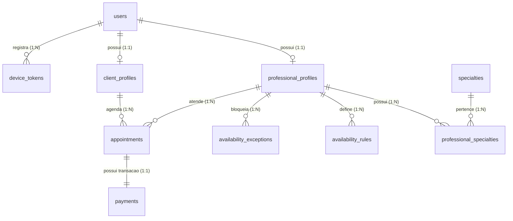

# ADR 0001: Modelagem e Estrutura do Banco de Dados Relacional (PostgreSQL)

* **Status:** Aceito
* **Data:** 2026-10-10
* **Decisores:** Time de Arquitetura e Engenharia FitConecta+
* **Contexto Técnico:** Go (Core API), Flutter (Web e Mobile), PostgreSQL 16+

---

## 1. Contexto e Problema

O **FitConecta+** é uma plataforma que conecta profissionais de educação física autônomos a clientes. O sistema precisa garantir:

1. **Garantia absoluta contra agendamento duplo (Race Conditions):** Dois clientes tentando reservar o mesmo profissional no mesmo intervalo de tempo simultaneamente não podem gerar conflito.
2. **Integração transacional de agendamento e pagamento:** O agendamento só é confirmado após a confirmação do pagamento. O split financeiro (10% para a plataforma e 90% para o profissional) deve ser rastreável e auditável.
3. **Gestão flexível de agenda:** Cálculo de disponibilidade baseado em regras recorrentes (semanais) e exceções pontuais (bloqueios, feriados, folgas).
4. **Precisão de fuso horário:** Profissionais e clientes podem estar em cidades ou fusos distintos.
5. **Segurança e Não-enumeração (Anti-IDOR/BOLA):** Identificadores expostos nas APIs públicas não podem ser sequenciais previsíveis.
6. **Desenvolvimento local ágil e produção robusta:** O banco deve rodar facilmente em Docker localmente e ser compatível com serviços gerenciados em nuvem (ex.: AWS RDS PostgreSQL).

---

## 2. Decisão Arquitetural

Decidimos adotar o **PostgreSQL (versão 16+)** como banco de dados relacional primário para o Core API, utilizando as seguintes convenções e mecanismos:

### 2.1 Identificadores (Chaves Primárias)
- **UUID (v4 ou v7):** Todas as tabelas expostas em endpoints públicos utilizam `UUID` como chave primária, prevenindo ataques de enumeração direta (IDOR).

### 2.2 Controle de Concorrência e Intervalos (Anti-Double Booking)
- Uso da extensão nativa **`btree_gist`**.
- Coluna gerada do tipo **`tstzrange`** (`period`) na tabela `appointments`.
- **Constraint de exclusão (`EXCLUDE USING gist`)**: Garante a nível de engine do banco de dados que nenhum profissional terá agendamentos sobrepostos nos status `pending_payment` e `confirmed`.

### 2.3 Tratamento Temporal e Fusos
- Armazenamento de datas e horas com fuso sempre em **`timestamptz` em UTC**.
- O fuso horário de referência do profissional é registrado em formato IANA (ex.: `'America/Sao_Paulo'`) no seu perfil para projeção correta de slots semanais (`availability_rules`).

### 2.4 Valores Monetários
- Todos os valores financeiros são armazenados como **inteiros em centavos** (`BIGINT` ou `INTEGER`), eliminando imprecisões de ponto flutuante em cálculos de split de 10%.

### 2.5 Stack de Acesso e Migrações em Go
- **Acesso ao banco:** `pgx/v5` (driver nativo de alta performance) em conjunto com **`sqlc`** (SQL puro compilado para código Go fortemente tipado e livre de SQL Injection).
- **Gerenciador de migrações:** **`goose`**, com arquivos SQL numerados e versionados no repositório.

---

## 3. Diagrama Entidade-Relacionamento (ER)



---

## 4. Esquema Detalhado das Tabelas (DDL)

```sql
-- Habilita extensoes necessarias
CREATE EXTENSION IF NOT EXISTS "uuid-ossp";
CREATE EXTENSION IF NOT EXISTS "citext";
CREATE EXTENSION IF NOT EXISTS "btree_gist";

-- ============================================================================
-- 1. USUARIOS E AUTENTICACAO
-- ============================================================================
CREATE TYPE user_role AS ENUM ('client', 'professional', 'admin');
CREATE TYPE user_status AS ENUM ('pending', 'active', 'suspended');

CREATE TABLE users (
    id UUID PRIMARY KEY DEFAULT uuid_generate_v4(),
    email CITEXT NOT NULL UNIQUE,
    password_hash VARCHAR(255) NOT NULL,
    role user_role NOT NULL,
    status user_status NOT NULL DEFAULT 'pending',
    created_at TIMESTAMPTZ NOT NULL DEFAULT NOW(),
    updated_at TIMESTAMPTZ NOT NULL DEFAULT NOW()
);

CREATE INDEX idx_users_email ON users(email);

-- ============================================================================
-- 2. PERFIS DOS PROFISSIONAIS (EXCLUSIVO AUTONOMOS - PF)
-- ============================================================================
CREATE TABLE professional_profiles (
    id UUID PRIMARY KEY DEFAULT uuid_generate_v4(),
    user_id UUID NOT NULL UNIQUE REFERENCES users(id) ON DELETE CASCADE,
    display_name VARCHAR(120) NOT NULL,
    bio TEXT,
    city VARCHAR(100) NOT NULL,
    state VARCHAR(2) NOT NULL,
    timezone VARCHAR(50) NOT NULL DEFAULT 'America/Sao_Paulo',
    session_price_cents INTEGER NOT NULL CHECK (session_price_cents > 0),
    cref_number VARCHAR(30),
    approved_at TIMESTAMPTZ,
    created_at TIMESTAMPTZ NOT NULL DEFAULT NOW(),
    updated_at TIMESTAMPTZ NOT NULL DEFAULT NOW()
);

CREATE INDEX idx_professionals_location ON professional_profiles(city, state);

-- Especialidades / Modalidades
CREATE TABLE specialties (
    id SERIAL PRIMARY KEY,
    name VARCHAR(50) NOT NULL UNIQUE
);

CREATE TABLE professional_specialties (
    professional_id UUID NOT NULL REFERENCES professional_profiles(id) ON DELETE CASCADE,
    specialty_id INTEGER NOT NULL REFERENCES specialties(id) ON DELETE CASCADE,
    PRIMARY KEY (professional_id, specialty_id)
);

-- ============================================================================
-- 3. PERFIL DO CLIENTE
-- ============================================================================
CREATE TABLE client_profiles (
    id UUID PRIMARY KEY DEFAULT uuid_generate_v4(),
    user_id UUID NOT NULL UNIQUE REFERENCES users(id) ON DELETE CASCADE,
    name VARCHAR(120) NOT NULL,
    phone VARCHAR(20),
    city VARCHAR(100),
    state VARCHAR(2),
    created_at TIMESTAMPTZ NOT NULL DEFAULT NOW(),
    updated_at TIMESTAMPTZ NOT NULL DEFAULT NOW()
);

-- ============================================================================
-- 4. DISPONIBILIDADE E AGENDA DO PROFISSIONAL
-- ============================================================================
CREATE TABLE availability_rules (
    id UUID PRIMARY KEY DEFAULT uuid_generate_v4(),
    professional_id UUID NOT NULL REFERENCES professional_profiles(id) ON DELETE CASCADE,
    weekday SMALLINT NOT NULL CHECK (weekday BETWEEN 0 AND 6), -- 0=Domingo, 6=Sabado
    start_time TIME NOT NULL,
    end_time TIME NOT NULL,
    slot_minutes SMALLINT NOT NULL DEFAULT 60 CHECK (slot_minutes > 0),
    valid_from DATE,
    valid_until DATE,
    created_at TIMESTAMPTZ NOT NULL DEFAULT NOW(),
    CONSTRAINT chk_rule_times CHECK (start_time < end_time)
);

CREATE INDEX idx_availability_rules_prof ON availability_rules(professional_id, weekday);

CREATE TABLE availability_exceptions (
    id UUID PRIMARY KEY DEFAULT uuid_generate_v4(),
    professional_id UUID NOT NULL REFERENCES professional_profiles(id) ON DELETE CASCADE,
    starts_at TIMESTAMPTZ NOT NULL,
    ends_at TIMESTAMPTZ NOT NULL,
    reason VARCHAR(255),
    created_at TIMESTAMPTZ NOT NULL DEFAULT NOW(),
    CONSTRAINT chk_exception_times CHECK (starts_at < ends_at)
);

CREATE INDEX idx_availability_exceptions_prof ON availability_exceptions(professional_id, starts_at, ends_at);

-- ============================================================================
-- 5. AGENDAMENTOS (APPOINTMENTS) COM CONSTRAINT DE EXCLUSAO
-- ============================================================================
CREATE TYPE appointment_status AS ENUM (
    'pending_payment',
    'confirmed',
    'cancelled_by_client',
    'cancelled_by_professional',
    'completed',
    'no_show'
);

CREATE TABLE appointments (
    id UUID PRIMARY KEY DEFAULT uuid_generate_v4(),
    professional_id UUID NOT NULL REFERENCES professional_profiles(id) ON DELETE RESTRICT,
    client_id UUID NOT NULL REFERENCES client_profiles(id) ON DELETE RESTRICT,
    starts_at TIMESTAMPTZ NOT NULL,
    ends_at TIMESTAMPTZ NOT NULL,
    period TSTZRANGE GENERATED ALWAYS AS (tstzrange(starts_at, ends_at)) STORED,
    status appointment_status NOT NULL DEFAULT 'pending_payment',
    reserved_until TIMESTAMPTZ, -- expiracao da pre-reserva caso o pagamento nao seja concluido
    cancelled_at TIMESTAMPTZ,
    cancel_reason TEXT,
    created_at TIMESTAMPTZ NOT NULL DEFAULT NOW(),
    updated_at TIMESTAMPTZ NOT NULL DEFAULT NOW(),
    CONSTRAINT chk_appointment_times CHECK (starts_at < ends_at),
    -- Garante que um profissional nao possa ter dois horarios sobrepostos em status ativos
    CONSTRAINT no_overlap_professional_appointment EXCLUDE USING gist (
        professional_id WITH =,
        period WITH &&
    ) WHERE (status IN ('pending_payment', 'confirmed'))
);

CREATE INDEX idx_appointments_client ON appointments(client_id, starts_at);
CREATE INDEX idx_appointments_prof ON appointments(professional_id, starts_at);
CREATE INDEX idx_appointments_status ON appointments(status);

-- ============================================================================
-- 6. PAGAMENTOS E SPLIT (10% PLATAFORMA / 90% PROFISSIONAL)
-- ============================================================================
CREATE TYPE payment_method AS ENUM ('pix', 'credit_card');
CREATE TYPE payment_status AS ENUM ('pending', 'paid', 'failed', 'refunded');

CREATE TABLE payments (
    id UUID PRIMARY KEY DEFAULT uuid_generate_v4(),
    appointment_id UUID NOT NULL UNIQUE REFERENCES appointments(id) ON DELETE RESTRICT,
    client_id UUID NOT NULL REFERENCES users(id) ON DELETE RESTRICT,
    professional_id UUID NOT NULL REFERENCES users(id) ON DELETE RESTRICT,
    amount_cents INTEGER NOT NULL CHECK (amount_cents > 0),
    platform_fee_cents INTEGER NOT NULL CHECK (platform_fee_cents >= 0),
    professional_net_cents INTEGER NOT NULL CHECK (professional_net_cents >= 0),
    method payment_method NOT NULL,
    status payment_status NOT NULL DEFAULT 'pending',
    gateway_transaction_id VARCHAR(120),
    gateway_payload JSONB,
    paid_at TIMESTAMPTZ,
    created_at TIMESTAMPTZ NOT NULL DEFAULT NOW(),
    updated_at TIMESTAMPTZ NOT NULL DEFAULT NOW(),
    CONSTRAINT chk_split_sum CHECK (platform_fee_cents + professional_net_cents = amount_cents)
);

CREATE INDEX idx_payments_status ON payments(status);
CREATE INDEX idx_payments_gateway_tx ON payments(gateway_transaction_id);

-- ============================================================================
-- 7. PUSH NOTIFICATIONS (PREPARADO PARA FASE POSTERIOR)
-- ============================================================================
CREATE TYPE device_platform AS ENUM ('android', 'ios', 'web');

CREATE TABLE device_tokens (
    id UUID PRIMARY KEY DEFAULT uuid_generate_v4(),
    user_id UUID NOT NULL REFERENCES users(id) ON DELETE CASCADE,
    platform device_platform NOT NULL,
    token TEXT NOT NULL UNIQUE,
    last_seen_at TIMESTAMPTZ NOT NULL DEFAULT NOW(),
    created_at TIMESTAMPTZ NOT NULL DEFAULT NOW()
);

CREATE INDEX idx_device_tokens_user ON device_tokens(user_id);
```

> **Nota (2026-11-01, revisada em 2026-11-02):** o [ADR 0012](0012-dados-pessoais-do-cliente.md) adiciona a `client_profiles` as colunas opcionais `birth_date DATE`, `sex client_sex`, `height_cm SMALLINT`, `weight_kg NUMERIC(5,1)`, `activity_level client_activity_level` e `objective TEXT` (migrations `0013_client_personal_data.sql` e `0014_client_activity_and_objective.sql`). O DDL acima é o estado original.

---

## 5. Regras de Negócio Implementadas no Banco

1. **Validação de Split Financeiro:**
   A constraint `chk_split_sum` garante que a soma de `platform_fee_cents` (10%) e `professional_net_cents` (90%) seja matematicamente idêntica a `amount_cents`, prevenindo arredondamentos indevidos ou perdas financeiras.
2. **Ciclo de Vida do Agendamento:**
   - Criação com `status = 'pending_payment'` e `reserved_until = NOW() + INTERVAL '10 minutes'`.
   - Se o pagamento for aprovado: transição para `'confirmed'`.
   - Se expirar: worker de background libera a vaga alterando para cancelado/expirado.
3. **Fila Transacional com `SKIP LOCKED`:**
   Para processamento assíncrono inicial (envio de e-mails e expiração de pré-reservas) sem necessidade de infraestrutura pesada externa:
   ```sql
   SELECT id, appointment_id FROM payments 
   WHERE status = 'pending' AND created_at < NOW() - INTERVAL '15 minutes'
   FOR UPDATE SKIP LOCKED;
   ```

---

## 6. Consequências

### Positivas
- **Impossibilidade de sobreposição de horários:** A integridade é garantida na camada de persistência através de álgebra relacional de intervalos (`tstzrange` + `gist`).
- **Segurança tipo-segura em Go:** O uso de `sqlc` com esse schema gera código Go com structs limpas, dispensando mapeamento manual ou riscos de runtime.
- **Rastreabilidade e Compliance:** Split de pagamentos e histórico de agendamentos contam com integridade referencial estrita (`ON DELETE RESTRICT` em agendamentos e pagamentos).
- **Paridade Local/Produção:** O mesmo DDL é executado via Docker Compose localmente e no AWS RDS PostgreSQL em produção.

### Pontos de Atenção & Mitigações
- **Requisito de extensão:** A extensão `btree_gist` precisa ser ativada na migração inicial (suportada nativamente tanto no Docker oficial quanto no AWS RDS).
- **Projeção de slots:** A expansão de regras semanais para datas reais deve ser feita na Core API em Go considerando o campo `timezone` cadastrado no `professional_profiles`.
- **Limpeza de pré-reservas:** É necessário um job leve em Go rodando periodicamente para liberar agendamentos cujo `reserved_until` expirou sem pagamento.
