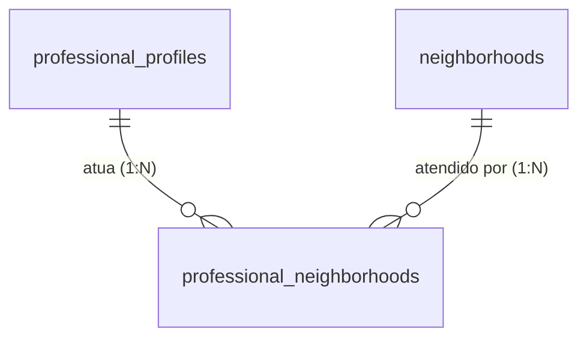

# ADR 0004: Bairros de Atuação dos Profissionais

* **Status:** Aceito
* **Data:** 2026-10-14
* **Decisores:** Time de Arquitetura e Engenharia FitConecta+
* **Contexto Técnico:** Go (Core API), Next.js (Web), Flutter (Mobile), PostgreSQL 16+

---

## 1. Contexto e Problema

Hoje o profissional declara apenas **cidade (`city`) e UF (`state`)** no seu perfil (`professional_profiles`, ver ADR 0001). Essa granularidade é insuficiente para o marketplace:

1. **Busca relevante:** numa cidade grande (ex.: Belo Horizonte), o cliente quer encontrar profissionais que atendam **no seu bairro** ou em bairros próximos, não em qualquer ponto do município.
2. **Conversão e logística:** a distância até o local do treino é fator decisivo de contratação; o cliente precisa saber a área de cobertura real.
3. **Diferenciação do profissional:** um profissional pode (e costuma) atuar em **vários bairros**, eventualmente em mais de uma cidade da região metropolitana.
4. **Filtro estruturado:** a API de listagem (`GET /api/v1/professionals`) precisa permitir filtro por bairro de forma eficiente e indexada.

Atualmente não existe nenhuma estrutura para essa informação (nem coluna, nem tabela, nem campo no cadastro). É necessário definir o **modelo de dados** para os bairros de atuação antes de implementar cadastro, edição e busca.

### Requisitos

- Um profissional pode atuar em **vários bairros** (N:N).
- Um bairro pertence a uma **cidade/UF**; o mesmo nome de bairro pode existir em cidades diferentes.
- Deve ser possível **filtrar** profissionais por bairro/cidade de forma indexada.
- Deve haver uma **lista canônica** de bairros (evitar "Savassi", "savassi", "Savassi " como entradas distintas), permitindo, porém, crescimento orgânico do catálogo.
- O modelo deve ser **retrocompatível**: perfis existentes sem bairros continuam válidos.

---

## 2. Decisão Arquitetural

Decidimos modelar os bairros de atuação com **catálogo canônico + tabela de junção N:N**, seguindo o mesmo padrão já adotado para especialidades (`specialties` + `professional_specialties`):

1. **`neighborhoods`** — catálogo de bairros, escopado por **UF + cidade** (texto), com nome e slug únicos dentro do município.
2. **`professional_neighborhoods`** — associação **N:N** entre `professional_profiles` e `neighborhoods`.

A localização-base do profissional (`city`/`state` em `professional_profiles`) é mantida como "cidade principal"; os bairros representam a **área de cobertura**, que pode abranger mais de um município.

### 2.1 Alternativas consideradas

| Alternativa | Prós | Contras | Decisão |
|---|---|---|---|
| **A. Coluna `TEXT[]` em `professional_profiles`** | Implementação trivial, sem junção | Sem integridade referencial, sem lista canônica, indexação/`GIN` limitada para filtro por bairro, difícil evoluir para dados IBGE | Rejeitada |
| **B. Texto livre (`service_area`)** | Simples | Não é filtrável, gera duplicidade e dados sujos | Rejeitada |
| **C. Catálogo `neighborhoods` + junção N:N** | Integridade referencial, lista canônica, filtro indexado, permite slug para SEO e métricas por bairro | Exige gerenciar o catálogo (seed/curadoria) | **Escolhida** |
| **D. Base oficial do IBGE (código de bairro)** | Padronização nacional, sem ambiguidade | Volume grande, dependência de carga externa e atualizações; overkill para o piloto | Postergada (evolução sobre C) |

### 2.2 Estratégia de formação do catálogo

- **Seed inicial** com bairros das cidades-alvo do piloto (ex.: Belo Horizonte/MG), garantindo dados úteis desde o primeiro momento.
- O profissional seleciona bairros existentes; se o bairro não existir, ele pode **sugerir um novo** (criação com `is_active = false` para curadoria) ou o cadastro é habilitado direto via flag de configuração.
- Evolução futura (opção D): vincular `neighborhoods` ao **código de município/bairro do IBGE** sem quebrar o modelo atual (colunas opcionais `ibge_city_code`, `ibge_neighborhood_code`).

### 2.3 Convenções

- **Identificador:** `SERIAL` para o catálogo, seguindo `specialties` (catálogo público, não sensível a enumeração).
- **Unicidade:** `(state, city, name)` e `(state, city, slug)` — o mesmo bairro em cidades diferentes é permitido.
- **Case-insensitive:** `name` em `CITEXT` (extensão já habilitada) para evitar duplicidade por capitalização.
- **Coerência com o perfil:** não há FK forçando o bairro pertencer à `city/state` do perfil (profissional pode atuar em municípios vizinhos); a consistência é validada na camada de serviço.
- **Limite de bairros por profissional:** regra de aplicação (ex.: `MaxNeighborhoods = 10`), análoga a `MaxPhotos = 3` (ADR 0003).

---

## 3. Diagrama Entidade-Relacionamento (ER)



`professional_neighborhoods` é a tabela de junção (N:N) entre `professional_profiles` e `neighborhoods`.

---

## 4. Esquema Detalhado (DDL)

```sql
-- ============================================================================
-- ADR 0004: Bairros de atuacao dos profissionais
-- Migracao versionada: infra/docker/postgres/migrations/0005_professional_neighborhoods.sql
-- Idempotente: pode ser executada com seguranca mais de uma vez.
-- ============================================================================

-- Catalogo de bairros (cresce organicamente, como specialties)
CREATE TABLE IF NOT EXISTS neighborhoods (
    id SERIAL PRIMARY KEY,
    state VARCHAR(2) NOT NULL,                 -- UF (ex.: 'MG')
    city VARCHAR(100) NOT NULL,                -- municipio (ex.: 'Belo Horizonte')
    name CITEXT NOT NULL,                      -- nome do bairro (case-insensitive)
    slug VARCHAR(140) NOT NULL,                -- identificador amigavel (ex.: 'savassi')
    is_active BOOLEAN NOT NULL DEFAULT TRUE,   -- FALSE = aguardando curadoria
    created_at TIMESTAMPTZ NOT NULL DEFAULT NOW(),
    updated_at TIMESTAMPTZ NOT NULL DEFAULT NOW(),
    CONSTRAINT uq_neighborhoods_name UNIQUE (state, city, name),
    CONSTRAINT uq_neighborhoods_slug UNIQUE (state, city, slug)
);

CREATE INDEX IF NOT EXISTS idx_neighborhoods_city ON neighborhoods(state, city);
CREATE INDEX IF NOT EXISTS idx_neighborhoods_slug ON neighborhoods(slug);

CREATE TRIGGER trg_neighborhoods_updated_at
    BEFORE UPDATE ON neighborhoods
    FOR EACH ROW
    EXECUTE FUNCTION update_updated_at_column();

-- Associacao N:N: profissional x bairros atendidos
CREATE TABLE IF NOT EXISTS professional_neighborhoods (
    professional_id UUID NOT NULL REFERENCES professional_profiles(id) ON DELETE CASCADE,
    neighborhood_id INTEGER NOT NULL REFERENCES neighborhoods(id) ON DELETE CASCADE,
    created_at TIMESTAMPTZ NOT NULL DEFAULT NOW(),
    PRIMARY KEY (professional_id, neighborhood_id)
);

CREATE INDEX IF NOT EXISTS idx_prof_neighborhoods_neighborhood
    ON professional_neighborhoods(neighborhood_id);
```

O `init.sql` deve ser atualizado com as mesmas tabelas para novas bases.

---

## 5. Regras de Negócio e Integridade

1. **Cardinalidade:** N:N via `professional_neighborhoods`; a chave primária composta `(professional_id, neighborhood_id)` impede duplicatas.
2. **Exclusão em cascata:** remover um profissional (`ON DELETE CASCADE`) ou um bairro remove os vínculos; remover um bairro não afeta o perfil.
3. **Unicidade canônica:** `UNIQUE (state, city, name)` (com `CITEXT`) e `UNIQUE (state, city, slug)` impedem duplicidade de bairro no mesmo município.
4. **Filtro indexado:** `idx_prof_neighborhoods_neighborhood` viabiliza "profissionais que atendem no bairro X"; `idx_neighborhoods_city` viabiliza listar bairros de uma cidade.
5. **Limite por profissional:** aplicado na camada de serviço (`MaxNeighborhoods`), retornando **400** ao exceder.
6. **Curadoria:** bairros com `is_active = false` não aparecem na busca pública (filtro `is_active = true`), mas podem ser associados e revisados.

---

## 6. Impacto na API e no Frontend (referência)

*Escopo deste ADR é o banco de dados; os itens abaixo orientam a implementação subsequente.*

| Método | Rota | Descrição |
|---|---|---|
| `GET` | `/api/v1/neighborhoods?city=&state=` | Lista bairros ativos de uma cidade |
| `GET` | `/api/v1/professionals?neighborhood_id=` | Filtra profissionais por bairro |
| `GET` | `/api/v1/professionals/me/neighborhoods` | Lista os bairros do profissional autenticado |
| `PUT` | `/api/v1/professionals/me/neighborhoods` | Define os bairros do profissional (`neighborhood_ids: []`) |

- Cadastro (`POST /auth/register`) e edição de perfil passam a aceitar `neighborhood_ids`.
- `ProfessionalProfile` (resposta pública) inclui `neighborhoods: [{ id, name, city, state }]`.
- Frontend: seleção de bairros no cadastro/perfil e filtro por bairro na busca (componente `FilterBar`).

---

## 7. Migração e Rollout

- Migração `infra/docker/postgres/migrations/0005_professional_neighborhoods.sql` (idempotente) para o schema, reconciliada em `init.sql`.
- Migração de seed `infra/docker/postgres/migrations/0006_seed_neighborhoods.sql` com bairros das cidades do piloto e associações dos profissionais de exemplo.
- **Retrocompatível:** nenhuma alteração nas colunas existentes; perfis sem bairros continuam válidos e aparecem na busca por cidade.

---

## 8. Consequências

### Positivas
- **Busca por bairro eficiente e indexada**, melhorando a relevância e a conversão.
- **Lista canônica** de bairros evita duplicidade e permite métricas (oferta/demanda por região).
- **Consistente com o padrão existente** de catálogo + N:N (`specialties`), reduzindo o custo cognitivo.
- **Evolutivo:** preparado para integração com códigos do IBGE (opção D) sem reescrita.

### Pontos de Atenção & Mitigações
- **Curadoria do catálogo:** o crescimento orgânico exige revisão; mitigado por `is_active` e fluxo de aprovação.
- **Duplicidade de bairros:** mitigada por `CITEXT` + unicidade `(state, city, name/slug)`.
- **Coerência cidade/bairro:** sem FK rígida entre `neighborhoods.city/state` e `professional_profiles.city/state`; validar na aplicação e alertar inconsistências.
- **Volume do catálogo nacional:** adiado; o piloto cobre apenas cidades-alvo.
