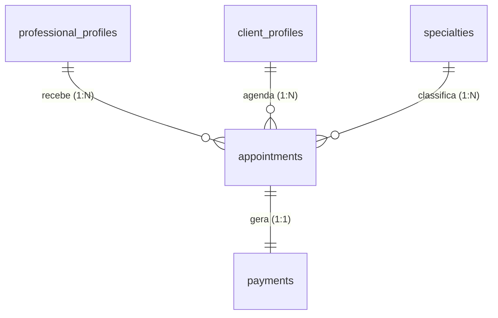

# ADR 0005: Fluxo de Agendamento de Sessão pelo Cliente

* **Status:** Aceito
* **Data:** 2026-10-15
* **Decisores:** Time de Arquitetura e Engenharia FitConecta+
* **Contexto Técnico:** Go (Core API), Next.js (Web), Flutter (Mobile), PostgreSQL 16+

> **Nota (2026-10-20):** o pagamento simulado e a opção "Pagar depois" descritos neste ADR foram substituídos pelo [ADR 0010](0010-pagamento-obrigatorio-pix-no-agendamento.md). O agendamento permanece `pending_payment` até o Pix ser confirmado por webhook.

---

## 1. Contexto e Problema

Na página de perfil do profissional (`/app/client/profissional/[id]`, ver ADR 0002), o botão **"Agendar sessão"** (`frontend/components/ProfessionalDetailView.tsx:207`) é hoje um elemento **sem ação** — um `<Button>` sem `onClick`. O seletor de horários (`frontend/components/Calendar.tsx:18`) apenas escreve no `console`, descartando o `starts_at`/`ends_at` selecionado. O cliente consegue **ver** a disponibilidade, mas **não consegue agendar**.

O backend, porém, já implementa todo o fluxo de agendamento (`internal/appointments`: criação com pré-reserva, pagamento com split 90/10, confirmação, cancelamento e listagem por cliente/profissional) e a geração de slots (`internal/availability`). O que falta é **definir a experiência e o contrato** que ligam o botão a esses recursos.

Requisitos funcionais informados:

1. Ao clicar em **"Agendar sessão"**, deve ser exibida uma **tela para o usuário informar o dia e o horário**.
2. Nessa tela, o usuário deve informar também o **tipo da aula**.
3. Após **concluir o agendamento**, o usuário deve conseguir **visualizar todos os agendamentos realizados**.

### Requisitos

- O cliente só pode escolher horários **realmente disponíveis** (gerados pela disponibilidade do profissional), nunca horários livres concorridos.
- O agendamento deve carregar o **tipo de aula** (ver §2.3) para dar contexto ao profissional.
- O cliente deve ter uma **tela de "Meus agendamentos"** listando status, data/hora, profissional e tipo de aula.
- O fluxo deve ser **retrocompatível** com os endpoints existentes (`POST /api/v1/appointments`, `POST /api/v1/appointments/{id}/confirm-payment`, `GET /api/v1/appointments`).
- Apenas o **cliente autenticado** agenda; o profissional não agenda em nome de outro (regra já vigente em `appointments.Service.Create`).

---

## 2. Decisão Arquitetural

Decidimos que a ação do botão **"Agendar sessão"** navega para uma **tela dedicada de agendamento** (`/app/client/agendamento/[professionalId]`, já prevista no ADR 0002), onde o cliente:

1. **Escolhe o dia** (calendário/`input type=date`, com `min = hoje`).
2. **Escolhe o horário** entre os **slots disponíveis** daquele dia (`GET /api/v1/professionals/{id}/slots?date=YYYY-MM-DD`).
3. **Escolhe o tipo da aula** (§2.3).
4. **Confirma**, criando o agendamento via `POST /api/v1/appointments`.

O agendamento nasce em **`pending_payment`** (pré-reserva de 10 minutos, já implementada) e é concluído pelo fluxo de pagamento existente (`POST /api/v1/appointments/{id}/confirm-payment` → `confirmed`), reaproveitando a tela de pagamento do ADR 0002. Ao final, o cliente é levado para **"Meus agendamentos"** (`/app/client/agendamentos`), alimentada por `GET /api/v1/appointments`.

### 2.1 Alternativas consideradas

| Alternativa | Prós | Contras | Decisão |
|---|---|---|---|
| **A. Modal sobre o perfil do profissional** | Sem navegação; contexto preservado | Fluxo denso (dia + hora + tipo + pagamento) em modal; difícil compartilhar/retomar pagamento; pior em mobile | Rejeitada |
| **B. Tela dedicada `/app/client/agendamento/[professionalId]`** | Passos claros; retomável; URL compartilhável; segue ADR 0002; separa agendamento de pagamento | Uma rota nova | **Escolhida** |
| **C. Wizard multi-página (profissional → slot → tipo → pagamento)** | Passo a passo guiado | Fragmenta o estado entre rotas; mais complexo; sem ganho no piloto | Postergada |
| **D. Reutilizar o `Calendar` atual no próprio card** | Mínimo esforço | Não comporta tipo de aula nem pagamento; estado de slot já é descartado hoje | Rejeitada |

### 2.2 Fluxo de Agendamento (passo a passo)

1. **Perfil do profissional** → botão "Agendar sessão" → `router.push('/app/client/agendamento/{professionalId}')`.
2. **Tela de agendamento** carrega o profissional (`getProfessional`) e, ao escolher a data, seus slots (`getProfessionalSlots`).
3. Usuário seleciona **dia**, **horário** (apenas slots `available`) e **tipo de aula**.
4. "Confirmar" → `POST /api/v1/appointments` com `{ professional_id, starts_at, ends_at, specialty_id, payment_method }`.
   - **201** → agendamento `pending_payment` + pagamento `pending`. Redireciona para `/app/client/pagamento/{appointmentId}`.
   - **409** (`ErrSlotAlreadyBooked`) → o horário foi tomado; recarregar slots e avisar.
5. **Pagamento** (tela do ADR 0002) → cobrança Pix → webhook do PSP → `confirmed`. O fluxo simulado foi substituído pelo [ADR 0010](0010-pagamento-obrigatorio-pix-no-agendamento.md).
6. **"Meus agendamentos"** (`/app/client/agendamentos`) → `GET /api/v1/appointments` (papel cliente) listando todos os agendamentos e seus status.

> Observação: a pré-reserva (`reserved_until = now + 10min`) evita que dois clientes confirmem o mesmo horário. A expiração automática da pré-reserva não paga fica fora do escopo deste ADR (ver §8).

### 2.3 "Tipo da Aula"

Interpretamos **"tipo da aula"** como a **especialidade do profissional** (ex.: Musculação, Pilates, Yoga, Funcional) — o catálogo `specialties` já associado a cada profissional via `professional_specialties` (N:N). Assim:

- A tela de agendamento lista **apenas as especialidades do profissional** (`professional.specialties`), já disponíveis em `ProfessionalProfile`.
- Persistimos a escolha em `appointments.specialty_id` (FK para `specialties`), **validando na camada de serviço** que a especialidade é oferecida pelo profissional (mesma abordagem de coerência de ADR 0004 §2.3).

| Alternativa | Prós | Contras | Decisão |
|---|---|---|---|
| **A. Especialidade do profissional** (`specialty_id`) | Reaproveita catálogo existente; filtrável/agregável; alinhado ao perfil | Requer FK + validação de vínculo | **Escolhida** |
| **B. Texto livre** | Flexível | Dados sujos, não agregável | Rejeitada |
| **C. Novo enum de modalidade (presencial/online)** | Útil para logística | Não representa "tipo de treino"; multiplica conceitos; pode ser adicionado depois | Postergada (campo futuro) |

### 2.4 Convenções

- **Rota de agendamento:** `/app/client/agendamento/[professionalId]` (ADR 0002); **rota de listagem:** `/app/client/agendamentos`.
- **Botão:** "Agendar sessão" apenas para o **cliente autenticado**; permanece visível no perfil. O handler substitui o placeholder atual.
- **Slot:** a tela deve preservar o objeto `Slot` (`starts_at`/`ends_at`), não apenas o rótulo formatado (correção necessária em `ProfessionalDetailView`/`Calendar`).
- **Payload:** `CreateAppointmentRequest` ganha `specialty_id` (inteiro). Mantido **opcional no contrato** (retrocompatível) e **obrigatório na UI** do agendamento.
- **Listagem:** reaproveita `GET /api/v1/appointments` (já resolve por papel: cliente → `ListByClient`).

### 2.5 Local da sessão e descrição

A tela de agendamento também coleta:

1. **Local da sessão** — um `select` com o **tipo de local** (`home`, `studio`, `online`), rótulos "Domicílio do cliente", "Estúdio do profissional" e "Online". Persistido em `appointments.location_type` (enum `appointment_location`). **Obrigatório na UI**, **opcional no contrato** (nullable, retrocompatível).
2. **Descrição** — texto livre (`location_notes`, até 500 caracteres) para detalhes do local/observações (ex.: endereço exato, ponto de referência). **Opcional**.

O serviço valida o `location_type` contra os valores permitidos (`ErrInvalidLocation` → **400**). Não há FK: o tipo é um enum fechado.

---

## 3. Diagrama Entidade-Relacionamento (ER)



`appointments.specialty_id` aponta para `specialties`; a coerência "especialidade ∈ especialidades do profissional" é validada na aplicação (§5).

---

## 4. Esquema Detalhado (DDL)

```sql
-- ============================================================================
-- ADR 0005: Tipo de aula (especialidade) no agendamento
-- Migracao versionada: infra/docker/postgres/migrations/0007_appointment_specialty.sql
-- Idempotente: pode ser executada com seguranca mais de uma vez.
-- ============================================================================

ALTER TABLE appointments
    ADD COLUMN IF NOT EXISTS specialty_id INTEGER
        REFERENCES specialties(id) ON DELETE RESTRICT;

CREATE INDEX IF NOT EXISTS idx_appointments_specialty
    ON appointments(specialty_id);
```

- Nenhuma coluna existente é alterada; `specialty_id` é **nullable** (retrocompatível com agendamentos sem tipo definido).
- O `init.sql` deve ser atualizado com a mesma coluna para novas bases.

```sql
-- ============================================================================
-- ADR 0005: Tipo de local e descricao do agendamento
-- Migracao versionada: infra/docker/postgres/migrations/0008_appointment_location.sql
-- Idempotente: pode ser executada com seguranca mais de uma vez.
-- ============================================================================

CREATE TYPE appointment_location AS ENUM ('home', 'studio', 'online');

ALTER TABLE appointments
    ADD COLUMN IF NOT EXISTS location_type appointment_location,
    ADD COLUMN IF NOT EXISTS location_notes TEXT;
```

- `location_type` e `location_notes` são **nullable** (retrocompatíveis).

---

## 5. Regras de Negócio e Integridade

1. **Apenas cliente agenda:** `appointments.Service.Create` já rejeita papéis diferentes de `client` (`ErrUnauthorized` → 403).
2. **Horário válido:** `starts_at < ends_at` e não pode estar no passado (regras já vigentes no serviço).
3. **Sem sobreposição:** a constraint `no_overlap_professional_appointment` (GiST sobre `period`) garante, no banco, que o profissional não tenha dois horários ativos sobrepostos — o conflito mapeia para `ErrSlotAlreadyBooked` (**409**).
4. **Tipo de aula válido:** ao receber `specialty_id`, o serviço valida que a especialidade pertence a `professional_specialties` daquele profissional; caso contrário, retorna **400**. `specialty_id` nulo é permitido (retrocompatibilidade).
5. **Preço e data:** o `amount_cents` do pagamento é o `session_price_cents` **atual** do profissional, capturado no momento da criação (histórico). `starts_at`/`ends_at` vêm do **slot selecionado**, nunca calculados no cliente.
6. **Split 90/10:** mantido o cálculo existente (`platform_fee = 10%`, `professional_net = 90%`), inalterado por este ADR.
7. **Local válido:** ao receber `location_type`, o serviço valida que é `home`, `studio` ou `online`; caso contrário, retorna **400** (`ErrInvalidLocation`). Nulo é permitido (retrocompatibilidade).
8. **Descrição:** `location_notes` é texto livre opcional (limite de 500 caracteres na UI).

---

## 6. Impacto na API e no Frontend (referência)

*Escopo deste ADR é a definição do fluxo; os itens abaixo orientam a implementação subsequente.*

**API (Core Go):**

| Método | Rota | Situação |
|---|---|---|
| `GET` | `/api/v1/professionals/{id}/slots?date=` | Já existe (público) — usado para o dia/horário |
| `POST` | `/api/v1/appointments` | Já existe — passa a aceitar `specialty_id`, `location_type` e `location_notes` |
| `POST` | `/api/v1/appointments/{id}/confirm-payment` | Já existe — conclui o agendamento |
| `GET` | `/api/v1/appointments` | Já existe — alimenta "Meus agendamentos" |

- `CreateAppointmentRequest`: + `specialty_id` (`int`, opcional), + `location_type` (`home|studio|online`, opcional), + `location_notes` (`string`, opcional).
- `Appointment` (resposta): + `specialty_id`, `specialty_name`, `location_type`, `location_notes`.
- `repository`/`service`: validar vínculo com `professional_specialties` e o valor de `location_type`; enriquecer a listagem com o nome da especialidade.

**Frontend (Next.js):**

- Botão "Agendar sessão" (`ProfessionalDetailView.tsx`) → navegação para a tela de agendamento.
- Nova página `/app/client/agendamento/[professionalId]` (componente `AgendamentoView`): dia + horário + tipo de aula + **local (select)** + **descrição (texto livre)** + confirmação.
- `Calendar` deve devolver o `Slot` selecionado (não só o rótulo).
- Nova página `/app/client/agendamentos` (componente `ClientAppointmentsView`) usando `getMyAppointments`; ativa o link "Meus agendamentos" do `Header` (hoje `href="#"`).
- Novos helpers em `lib/` : `createAppointment(...)`, `confirmAppointmentPayment(...)`; rótulos de local em `lib/format.ts` (`LOCATION_TYPE_OPTIONS`, `locationLabel`).

---

## 7. Migração e Rollout

- Migração `infra/docker/postgres/migrations/0007_appointment_specialty.sql` (idempotente) para adicionar `specialty_id`; reconciliada em `init.sql`.
- Migração `infra/docker/postgres/migrations/0008_appointment_location.sql` (idempotente) para `location_type`/`location_notes`; reconciliada em `init.sql`.
- Feature isolável: o botão só passa a navegar quando a tela de agendamento existir; o backend aceita os novos campos como opcionais, então versões antigas do front continuam funcionando.
- **Retrocompatível:** agendamentos existentes permanecem com `specialty_id`, `location_type` e `location_notes` nulos.

---

## 8. Consequências

### Positivas
- **Fecha o funil do marketplace:** o cliente passa de "ver" para "agendar" na mesma plataforma, aproveitando o backend já pronto.
- **Reaproveita o modelo existente** (slots, pré-reserva, split, listagem), minimizando código novo.
- **Tipo de aula com integridade:** `specialty_id` é catálogo, permitindo filtros e métricas (ex.: demanda por Pilates).
- **UX compartilhável e retomável:** rotas dedicadas para agendamento, pagamento e listagem.

### Pontos de Atenção & Mitigações
- **Expiração da pré-reserva:** `reserved_until` já é gravado, mas ainda não há job que libere horários não pagos. Mitigação: job/limpeza agendada (ou `DELETE` de expirados na listagem) — fora do escopo deste ADR, endereçado em ADR próprio.
- **Pagamento real:** definido no [ADR 0010](0010-pagamento-obrigatorio-pix-no-agendamento.md) — Pix obrigatório, confirmação por webhook e expiração da pré-reserva. Cartão fica para fase futura.
- **Corrida por horário:** mitigada pela constraint de exclusão + **409**; a UI deve recarregar os slots ao receber conflito.
- **Coerência tipo × profissional:** sem FK composta; validada no serviço (retorno **400**), evitando especialidades não oferecidas.
- **Concorrência de timezone:** o slot é gerado no fuso do profissional (`America/Sao_Paulo` por padrão); a UI deve exibir no fuso do slot retornado, evitando conversões locais indevidas.
