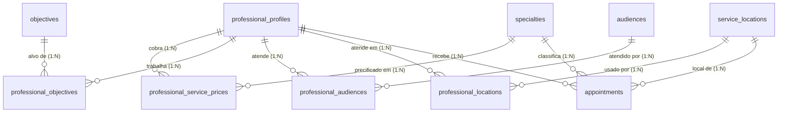

# ADR 0011: Serviços, Objetivos, Públicos, Formatos e Preços por Serviço

* **Status:** Proposto
* **Data:** 2026-10-30
* **Decisores:** Time de Arquitetura e Engenharia FitConecta+
* **Contexto Técnico:** Go (Core API), Next.js (Web), PostgreSQL 16+

> **Nota (2026-10-30):** implementação em etapas. A migration `0011_professional_services.sql` entrega a parte aditiva das fases 1-2 (catálogos, vínculos, textos de público e locais). Preços por serviço, backfill, remoção de `professional_specialties` e as colunas de formato/local no agendamento ficam na `0012` (fase 3). O DDL das seções 4.2 e 4.6 é o alvo final.

---

## 1. Contexto e Problema

O perfil do profissional hoje declara **especialidades** (`specialties` + `professional_specialties`, ver ADR 0001) e **um único preço de sessão** (`professional_profiles.session_price_cents`). Esse modelo mistura conceitos e não sustenta a busca que o produto precisa:

1. **Serviço × objetivo:** o catálogo atual tem `Emagrecimento` e `Hipertrofia` (objetivos) ao lado de `Pilates` (serviço) — `infra/docker/postgres/init.sql:329-338` e `infra/docker/postgres/migrations/0004_seed_mock_professionals.sql:9-16`.
2. **Duplicidade:** `Funcional` duplica `Treinamento Funcional`; `Mobilidade` duplica `Alongamento / Mobilidade` (seed `0004:9-16` e `init.sql:329-338`).
3. **Preço único:** um profissional que oferece musculação, corrida e TAF não consegue informar preços diferentes, nem separar presencial de online. O agendamento cobra sempre `session_price_cents` (`backend/core-api/internal/appointments/repository.go:521`).
4. **Formato inexistente:** o ADR 0005 §2.3 postergou o formato; o local é um enum fechado `home | studio | online` (`init.sql:194`), insuficiente para os locais reais de atendimento (condomínio, parque, hotel).
5. **Público e objetivo inexistentes:** não há como o cliente filtrar por objetivo nem por público, e a busca só cobre serviço, cidade e bairro (`backend/core-api/internal/professionals/repository.go:58`).

A proposta recebida separa a informação em **eixos independentes** e usa caixas clicáveis para que o cliente encontre apenas profissionais compatíveis com serviço, objetivo, público, formato, local e horário.

### Requisitos

- **Serviços oferecidos** (não "modalidades"): inclui itens que não são modalidade, como preparação para TAF e avaliação física.
- **Objetivos** com os quais o profissional trabalha, independentes do serviço.
- **Públicos atendidos** com poucas opções iniciais; públicos específicos aparecem só ao marcar "Atendimento a públicos específicos".
- **Formato** presencial, online ou ambos, sem opção redundante.
- **Locais de atendimento presencial** + cidade e bairros (estes já resolvidos no ADR 0004).
- **Preço por serviço e por formato**, com duração padrão de 60 minutos no MVP.
- Tudo **filtrável** e usado na compatibilidade da busca.
- **Retrocompatível**: perfis, agendamentos e pagamentos existentes continuam válidos.

---

## 2. Decisão Arquitetural

Modelar seis eixos como **catálogos canônicos + junções N:N**, seguindo o padrão já usado para especialidades e bairros, com **um único preço por serviço e formato**.

1. **Serviços:** `specialties` passa a ser o catálogo de serviços oferecidos. O nome da tabela é mantido (ver §2.1, alternativa E) e o rótulo na UI muda para "Serviços oferecidos".
2. **Objetivos:** `objectives` + `professional_objectives`.
3. **Públicos:** `audiences` (com `is_specific`) + `professional_audiences`; textos livres em `professional_profiles`.
4. **Formato e preço:** `professional_service_prices (professional_id, specialty_id, format, price_cents)`. **Oferecer um serviço é ter ao menos uma linha de preço** — a tabela substitui `professional_specialties` e elimina a possibilidade de serviço ofertado sem preço.
5. **Locais:** `service_locations` + `professional_locations` (no perfil, não por serviço no MVP).
6. **Duração:** fixa em 60 minutos, já refletida em `availability_rules.slot_minutes` (`init.sql:159`); sem coluna nova.

Cidade e bairros permanecem como estão (ADR 0004). O agendamento passa a carregar **formato** e **local escolhido**, e o preço é lido da tabela de preços no momento da criação.

### 2.1 Alternativas consideradas

| Alternativa | Prós | Contras | Decisão |
|---|---|---|---|
| **A. Manter preço único (`session_price_cents`)** | Zero mudança; pagamento intacto | Não representa serviços diferentes nem online/presencial; preço exibido fica errado | Rejeitada |
| **B. Preço por serviço, sem formato** | Menos linhas | Serviço presencial e online quase sempre têm preços diferentes; exigiria segundo campo depois | Rejeitada |
| **C. Enum de formato no perfil (`presencial`/`online`/`ambos`)** | Leitura simples | Pode divergir dos preços (marcar "ambos" sem preço online); terceiro valor é redundante | Rejeitada |
| **D. Preço por serviço × formato (`professional_service_prices`)** | Fonte única de verdade; "ambos" = duas linhas; formato derivado; filtrável | Mais uma junção; exige migrar o preço atual | **Escolhida** |
| **E. Renomear `specialties` → `services` e `appointments.specialty_id` → `service_id`** | Semântica correta no schema | Renomeação mecânica em ~15 arquivos, contrato público e ADR 0005, sem mudança de comportamento | Postergada (dívida registrada, §8) |
| **F. Preço por serviço + local por serviço** | Granularidade máxima | Profissional quase sempre atende nos mesmos locais; multiplica o cadastro | Postergada |
| **G. Tabela separada de "ofertas" + preços** | Separa conceito de oferta | Duplica a junção que a tabela de preços já resolve; permite oferta sem preço | Rejeitada |

### 2.2 Catálogo inicial

**Serviços** (`specialties`): Musculação e treino de força, Treinamento funcional, Treinamento de corrida, Alongamento e mobilidade, Pilates solo, Preparação física esportiva, Preparação para TAF e testes físicos, Avaliação física.

**Objetivos** (`objectives`): Emagrecimento, Ganho de massa muscular, Ganho de força, Condicionamento físico, Mobilidade e flexibilidade, Iniciação à atividade física, Retorno à atividade física, Saúde e bem-estar, Preparação para corrida, Performance esportiva, Preparação para prova ou teste físico.

**Públicos** (`audiences`): `Adultos em geral` e `Iniciantes` com `is_specific = false`; `Pessoas com 60 anos ou mais`, `Gestantes`, `Mulheres no pós-parto`, `Pessoas com deficiência`, `Pessoas com diabetes`, `Pessoas com hipertensão`, `Pessoas com obesidade`, `Pessoas em retorno após lesão, com liberação para atividade física` e `Outro público específico` com `is_specific = true`.

**Locais** (`service_locations`): Residência do cliente, Academia do condomínio, Academia comercial (quando houver autorização), Parque ou espaço público, Hotel, Estúdio ou espaço próprio do profissional.

### 2.3 Convenções

- **"Presencial e online" não é dado**: é a UI mostrando que existem as duas linhas de preço. Nenhum enum de três valores.
- **Público específico**: um único catálogo com `is_specific`; a UI agrupa. "Atendimento a públicos específicos" é apenas o toggle que revela as caixas específicas, não uma linha do catálogo.
- **Outro público**: `Outro público específico` é linha do catálogo; ao marcá-la, `audience_other` (texto) passa a ser obrigatório.
- **Experiência com o público**: `audience_experience` é **um** campo opcional no perfil, não um texto por público (§8).
- **Preço**: inteiro em centavos, `CHECK (price_cents > 0)`. Presencial e online são linhas distintas.
- **Formato**: `service_format` com `in_person` e `online`, reaproveitando o vocabulário de `appointment_location`.
- **Limites**: ao menos um serviço com preço; presencial exige ao menos um local; online exige preço online; `MaxNeighborhoods` e demais limites existentes permanecem.
- **Compatibilidade**: perfis antigos continuam válidos; o preço legado é apenas fallback até a limpeza (§7).

---

## 3. Diagrama Entidade-Relacionamento (ER)



`professional_service_prices` é a junção N:N entre profissional e serviço e, ao mesmo tempo, a tabela de preço por formato. `professional_specialties` deixa de existir.

---

## 4. Esquema Detalhado (DDL)

Migração versionada: `infra/docker/postgres/migrations/0011_professional_services.sql`, idempotente e reconciliada em `init.sql`.

```sql
-- 4.1 Catálogos
CREATE TABLE IF NOT EXISTS objectives (
    id SERIAL PRIMARY KEY,
    name VARCHAR(80) NOT NULL UNIQUE
);

CREATE TABLE IF NOT EXISTS audiences (
    id SERIAL PRIMARY KEY,
    name VARCHAR(120) NOT NULL UNIQUE,
    is_specific BOOLEAN NOT NULL DEFAULT FALSE
);

CREATE TABLE IF NOT EXISTS service_locations (
    id SERIAL PRIMARY KEY,
    name VARCHAR(120) NOT NULL UNIQUE
);

-- 4.2 Formato e preço por serviço
CREATE TYPE service_format AS ENUM ('in_person', 'online');

CREATE TABLE IF NOT EXISTS professional_service_prices (
    professional_id UUID NOT NULL REFERENCES professional_profiles(id) ON DELETE CASCADE,
    specialty_id INTEGER NOT NULL REFERENCES specialties(id) ON DELETE RESTRICT,
    format service_format NOT NULL,
    price_cents INTEGER NOT NULL CHECK (price_cents > 0),
    created_at TIMESTAMPTZ NOT NULL DEFAULT NOW(),
    updated_at TIMESTAMPTZ NOT NULL DEFAULT NOW(),
    PRIMARY KEY (professional_id, specialty_id, format)
);

CREATE INDEX IF NOT EXISTS idx_service_prices_specialty
    ON professional_service_prices(specialty_id, format);

-- 4.3 Objetivos e públicos do profissional
CREATE TABLE IF NOT EXISTS professional_objectives (
    professional_id UUID NOT NULL REFERENCES professional_profiles(id) ON DELETE CASCADE,
    objective_id INTEGER NOT NULL REFERENCES objectives(id) ON DELETE RESTRICT,
    PRIMARY KEY (professional_id, objective_id)
);

CREATE TABLE IF NOT EXISTS professional_audiences (
    professional_id UUID NOT NULL REFERENCES professional_profiles(id) ON DELETE CASCADE,
    audience_id INTEGER NOT NULL REFERENCES audiences(id) ON DELETE RESTRICT,
    PRIMARY KEY (professional_id, audience_id)
);

-- 4.4 Locais de atendimento presencial
CREATE TABLE IF NOT EXISTS professional_locations (
    professional_id UUID NOT NULL REFERENCES professional_profiles(id) ON DELETE CASCADE,
    location_id INTEGER NOT NULL REFERENCES service_locations(id) ON DELETE RESTRICT,
    PRIMARY KEY (professional_id, location_id)
);

-- 4.5 Textos livres do público
ALTER TABLE professional_profiles
    ADD COLUMN IF NOT EXISTS audience_other TEXT,
    ADD COLUMN IF NOT EXISTS audience_experience TEXT;

-- 4.6 Formato e local no agendamento (legado mantido no ADR 0005)
ALTER TABLE appointments
    ADD COLUMN IF NOT EXISTS format service_format,
    ADD COLUMN IF NOT EXISTS service_location_id INTEGER
        REFERENCES service_locations(id) ON DELETE RESTRICT;

CREATE INDEX IF NOT EXISTS idx_appointments_service_location
    ON appointments(service_location_id);
```

### 4.7 Migração de dados

```sql
-- Preço atual vira preço presencial de todos os serviços já associados.
INSERT INTO professional_service_prices (professional_id, specialty_id, format, price_cents)
SELECT ps.professional_id, ps.specialty_id, 'in_person', p.session_price_cents
FROM professional_specialties ps
JOIN professional_profiles p ON p.id = ps.professional_id
ON CONFLICT DO NOTHING;

-- A tabela antiga deixa de existir; a oferta passa a ser derivada dos preços.
DROP TABLE IF EXISTS professional_specialties;

-- O preço único vira legado (fallback), não fonte de verdade.
ALTER TABLE professional_profiles
    ALTER COLUMN session_price_cents DROP NOT NULL;
```

A migração de **catálogo** (não apenas de schema) precisa de curadoria:

- `Funcional` → mesclar em `Treinamento funcional` (mover vínculos e remover a linha duplicada).
- `Mobilidade` → mesclar em `Alongamento e mobilidade`.
- `Hipertrofia` e `Emagrecimento` → passam a objetivos; os vínculos viram `professional_objectives` e as linhas saem dos serviços.
- `Crossfit` e `Natação` não estão no catálogo proposto: permanecem ativos para não quebrar perfis existentes, com decisão de curadoria pendente (não entram no seed inicial).
- `Yoga` e `Condicionamento Físico` seguem a mesma regra de curadoria: `Yoga` permanece como serviço legado; `Condicionamento físico` é objetivo.

---

## 5. Regras de Negócio e Integridade

1. **Serviço ofertado = preço cadastrado.** Não existe vínculo de serviço sem preço; a validação de "o profissional oferece o serviço" consulta `professional_service_prices`.
2. **Formato coerente:** o preço do agendamento é o da combinação `(profissional, serviço, formato)`. Se o cliente escolher online e não houver preço online, o serviço não aparece para ele.
3. **Presencial exige local:** ao menos um `professional_locations`; o local escolhido no agendamento precisa estar entre os locais do profissional.
4. **Online não tem local:** `service_location_id` fica nulo quando `format = 'online'`.
5. **Preço histórico:** `payments` continua guardando o valor capturado na criação; mudanças posteriores de preço não afetam agendamentos existentes.
6. **Público:** selecionar `Outro público específico` exige `audience_other` não vazio; `audience_experience` é opcional.
7. **Objetivos e públicos** são listas canônicas; ids inexistentes retornam **400**.
8. **Compatibilidade:** agendamentos antigos mantêm `specialty_id`, `location_type` e `location_notes`; novos usam `format` e `service_location_id`.

---

## 6. Impacto na API e no Frontend

**API (Core Go):**

| Método | Rota | Situação |
|---|---|---|
| `GET` | `/api/v1/catalogs` | Novo — serviços, objetivos, públicos e locais em uma chamada |
| `PUT` | `/api/v1/professionals/me/services` | Novo — serviços com preço por formato (substitui `/me/specialties`) |
| `PUT` | `/api/v1/professionals/me/objectives` | Novo |
| `PUT` | `/api/v1/professionals/me/audiences` | Novo — inclui `audience_other` e `audience_experience` |
| `PUT` | `/api/v1/professionals/me/locations` | Novo |
| `GET` | `/api/v1/professionals` | Passa a devolver serviços com preço, objetivos, públicos e locais |
| `POST` | `/api/v1/appointments` | Passa a aceitar `format` e `service_location_id`; valida serviço/formato/local |

- `ProfessionalProfile` (resposta): + `services` (com `in_person_price_cents` e `online_price_cents`), `objectives`, `audiences`, `audience_other`, `audience_experience`, `locations`.
- `specialty_id` permanece no contrato de agendamento (serviço escolhido); `location_type` permanece por retrocompatibilidade.
- O preço exibido no catálogo é o menor preço entre as ofertas (ou "a partir de").

**Frontend (Next.js):**

- `ProfileView`: seção "Serviços oferecidos" com chip + valores presencial/online; seções Objetivos, Público (com expansão de específicos e texto) e Locais.
- `FilterBar`/`HomeView`: filtros por objetivo, público, formato e local, mantendo serviço, cidade e bairro.
- `ProfessionalCard`/`ProfessionalDetailView`: serviços, preços por formato, objetivos, públicos e locais.
- `AgendamentoView`: passo de formato e local restrito aos locais do profissional; preço da combinação escolhida.
- `lib/types.ts` e `lib/catalog.ts` acompanham os novos contratos.

---

## 7. Migração e Rollout

Ordem em etapas entregáveis:

1. **Catálogos + perfil** (serviços, objetivos, públicos) — sem tocar preço; migration 0011 e endpoints de leitura/escrita.
2. **Locais + formato** — exibição e cadastro; sem impacto no pagamento.
3. **Preço por serviço + agendamento/pagamento** — etapa de maior risco; backfill, troca do cálculo em `appointments` e testes de criação/pagamento.
4. **Filtros e exibição na busca.**
5. **Documentação** (`openapi.yaml`, readme, nota no ADR 0005) e limpeza do catálogo legado.

- A migration é aditiva até a etapa 3; `session_price_cents` fica nullable e é usada como fallback para perfis ainda não migrados.
- Rollback: as colunas e tabelas novas são nullable/aditivas; `professional_specialties` pode ser recriada a partir de `professional_service_prices` (perdendo a distinção de formato, que é reconstruível).
- **Dados reais:** o backfill atribui o preço único a todos os serviços como presencial. Profissionais que atendem online precisam revisar o cadastro.

---

## 8. Consequências

### Positivas

- Conceitos separados: serviço, objetivo, público, formato, local e preço deixam de competir no mesmo catálogo.
- Busca e compatibilidade com dados padronizados, sem dezenas de opções na cara do profissional.
- Preço por serviço e formato, que é o que o cliente precisa comparar.
- "Presencial e online" deixa de ser um estado que pode divergir dos preços.
- Reaproveita o padrão de catálogo + junção já usado em bairros e especialidades.

### Riscos e mitigações

- **Etapa 3 mexe em dinheiro:** preço passa a vir de `professional_service_prices`. Mitigação: testes de criação/pagamento, fallback legado e rollout isolado.
- **Catálogo exige curadoria:** sem mesclar duplicatas e mover objetivos, a busca continua suja. Mitigação: migração de dados na mesma entrega.
- **Consulta N+1:** o perfil já carrega especialidades e bairros em consultas separadas (`professionals/repository.go:97-107`); mais quatro relações aumentam o custo. Aceitável no piloto; trocar por agregação em lote quando o catálogo crescer.
- **Filtros no cliente:** `HomeView` filtra localmente; com mais eixos isso não escala. Migrar para query params do `GET /professionals` quando a lista passar de algumas centenas.
- **Duração fixa de 60 min:** `Avaliação física` e `TAF` podem ter outra duração; vira coluna por serviço em ADR futuro.
- **Dívida de nomenclatura:** `specialties`/`specialty_id` cobrem "serviços". Renomear quando houver consumidores externos ou antes do app mobile — hoje seria churn sem ganho.

### Fora de escopo

- Duração por serviço, local por serviço, geolocalização/raio, ranking, fluxo de autorização de academia comercial, experiência estruturada por público, renomeação de `specialties` e catálogo IBGE.
