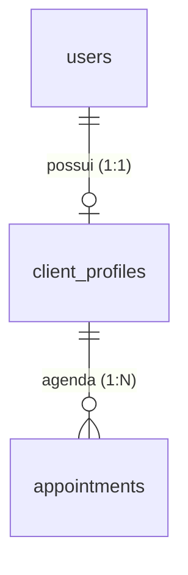

# ADR 0012: Dados Pessoais e Físicos do Cliente (Nascimento, CPF, Sexo, Altura, Peso, Nível de Atividade e Objetivo)

* **Status:** Aceito
* **Data:** 2026-11-01
* **Decisores:** Time de Arquitetura e Engenharia FitConecta+
* **Contexto Técnico:** Go (Core API), Next.js (Web), PostgreSQL 16+

> **Nota de numeração (2026-11-01):** a migration desta feature é **`0013_client_personal_data.sql`**. O número `0012` está reservado pelo [ADR 0011](0011-servicos-objetivos-publicos-e-precos.md) (§7, linha 8) para a fase 3 de preços por serviço. A divergência entre o número do ADR e o da migration é intencional: o ADR 0011 mantém a prioridade sobre a `0012`.

> **Revisão (2026-11-03):** foi adicionado **`cpf`** opcional (11 dígitos, `CHECK` de formato, máscara só na tela). É dado pessoal comum, não sensível; entra no mesmo `PUT` de substituição total. A validação aceita `000.000.000-00` ou só dígitos, mas **não** confere os dígitos verificadores (§8). Migration `0015_client_cpf.sql`.

> **Revisão (2026-11-02):** o "tipo físico" (`body_type`) foi substituído por **`activity_level`** ("faço atividades": sedentário / casualmente / frequentemente) e foi adicionado **`objective`** em texto livre. Motivo: o cliente não sabe se classificar por compleição e o dado não tinha uso no produto; hábito semanal e objetivo declarado servem para personalizar o treino. A `body_type` nunca chegou a ser preenchida e a migration `0014_client_activity_and_objective.sql` a remove do schema. Também nesta revisão: a data de nascimento passou para o cartão "Conta" e os textos de apoio redundantes saíram da tela.

---

## 1. Contexto e Problema

O cliente se cadastra sem informar nada sobre o próprio corpo. O profissional recebe um nome e um telefone e precisa prescrever treino no escuro.

1. **`users` não tem dado pessoal.** A tabela guarda apenas credenciais e estado da conta: `id, email, password_hash, role, status, status_reason, status_changed_at, created_at, updated_at` (`infra/docker/postgres/init.sql:26-37`).
2. **`client_profiles` guarda só contato.** `id, user_id, name, phone, city, state` e timestamps (`infra/docker/postgres/init.sql:171-180`), preenchidos no cadastro do cliente (`backend/core-api/internal/auth/repository.go:123-142`).
3. **A data de nascimento é coletada e descartada.** O cadastro tem campo obrigatório `birthdate` (`frontend/app/auth/register/page.tsx:269-277`), valida o formato (`:78-82`) e envia no corpo (`:153`). `RegisterRequest` não tem esse campo (`backend/core-api/internal/auth/model.go:27-42`) e o `INSERT` do cliente não o grava (`backend/core-api/internal/auth/repository.go:123-127`). O dado morre no `json.Decoder` e não existe coluna para recebê-lo. **Este ADR não mexe no cadastro**: o formulário de registro fica como está (decisão de produto, §2 item 8).
4. **Não existe módulo de cliente na API.** O roteador monta `auth`, `professionals`, `specialties`, `catalogs`, `neighborhoods`, `availability`, `appointments`, `payments` e `admin` (`backend/core-api/cmd/api/main.go:192-202`); não há `internal/clients`. Só o profissional tem `/me/profile` (`backend/core-api/internal/professionals/handler.go:54-72`).
5. **A área do cliente não tem tela de perfil.** `frontend/app/app/client/` tem `page.tsx`, `agendamentos`, `agendamento`, `pagamento` e `profissional` — nenhum `perfil`. O [ADR 0002](0002-definicao-das-paginas.md:19) já previa `/app/client/perfil` e o mapeamento `GET/PUT /api/v1/clients/:id` (`:41`); nunca foi implementado.
6. **O agendamento não depende disso.** O fluxo do [ADR 0005](0005-fluxo-de-agendamento-de-sessao.md) (§2.2) e do [ADR 0010](0010-pagamento-obrigatorio-pix-no-agendamento.md) (§2.3) usa `professional_id`, `starts_at`, `ends_at`, `specialty_id`, `location_type` e `payment_method`. O único dado do cliente lido na criação é o `client_profiles.id` derivado do token (`backend/core-api/internal/appointments/service.go:89` → `appointments/repository.go:514`).

### Requisitos

- Registrar **data de nascimento, CPF, sexo, altura, peso, frequência de atividades e objetivo** do cliente, todos **opcionais**.
- Página nova acessível **depois do login**, sem onboarding, modal ou redirecionamento obrigatório, e sem alterar o cadastro inicial.
- Não alterar o fluxo de agendamento nem o de pagamento; nada novo pode ser obrigatório para agendar.
- Devolver **idade e IMC calculados** na leitura, sem armazená-los.
- Um único endpoint de leitura e um de escrita, derivados do token (sem id na URL).
- Tela de perfil no padrão visual existente, com estados de carregamento, erro e sucesso.
- Tratar os dados como dados pessoais e, na parte física, como dado de saúde (LGPD), com o menor privilégio de leitura possível.

---

## 2. Decisão Arquitetural

**Estender `client_profiles` com sete colunas nullable, dois enums pequenos e um módulo `clients` na API com `GET/PUT /api/v1/clients/me/profile`.** Idade e IMC são derivados na resposta, nunca colunas.

1. **Onde:** `client_profiles`. É a tabela 1:1 do cliente (`init.sql:173`), já é o alvo do cadastro e já tem trigger de `updated_at` (`init.sql:182-185`). Uma tela, um dono, um caminho de escrita.
2. **Campos no MVP:** `birth_date DATE`, `sex client_sex`, `height_cm SMALLINT`, `weight_kg NUMERIC(5,1)`, `activity_level client_activity_level`, `objective TEXT`, `cpf VARCHAR(11)`. Todos NULL = "não informado".
3. **Fora do MVP:** `experience_level` (ver §2.1, alternativa J) e histórico de peso (alternativa G).
4. **`sex`, não `gender`:** o único uso previsto é cálculo (estimativa metabólica, referência de carga), não identidade. Se o produto precisar de identidade de gênero, será **outro** campo, com outro nome — nunca o mesmo.
5. **Frequência de atividades, não tipo físico:** "faço atividades" com três opções (`sedentary`, `casual`, `frequent`) é uma variável que o cliente sabe responder sobre si e que serve para calibrar volume. Tipo físico (compleição) saiu na revisão de 2026-11-02: era autopercepção sem uso no produto. O objetivo é texto livre, porque cada cliente descreve a própria meta com palavras diferentes.
6. **Escrita substitui os sete campos.** `PUT` recebe o conjunto completo; campo ausente ou `null` significa "não informado". Evita semântica de `PATCH` e evita limpar dado por omissão acidental quando o formulário envia tudo.
7. **Rota derivada do token:** `/clients/me/profile`, sem id na URL. Substitui o `GET/PUT /api/v1/clients/:id` do ADR 0002 (`docs/adr/0002-definicao-das-paginas.md:41`).
8. **Opcional de ponta a ponta, e o cadastro inicial não muda.** Nenhum campo é obrigatório; nada bloqueia login, busca, agendamento ou pagamento; não há onboarding, modal nem redirecionamento forçado. `POST /auth/register` continua pedindo exatamente o que pede hoje — os dados físicos são preenchidos depois, na página nova, quando o cliente quiser.

### 2.1 Alternativas consideradas

| Alternativa | Prós | Contras | Decisão |
|---|---|---|---|
| **A. Colunas em `client_profiles`** | Uma tabela, uma escrita, sem join; trigger de `updated_at` já existe; casa com a tela | Mistura contato e dado físico na mesma linha | **Escolhida** |
| **B. Tabela nova `client_personal_data` (1:1)** | Separa ciclo de vida e permite permissão por tabela | Segundo `INSERT`/`UPDATE`, join em toda leitura e risco de perfil sem linha; a API já autoriza por rota, não por tabela | Rejeitada |
| **C. Colunas em `users`** | Um lugar por pessoa | `users` é autenticação; profissional não tem os campos; mistura domínios e amplia o alcance de qualquer query de auth | Rejeitada |
| **D. `JSONB personal_data`** | Zero migration futura | Sem `CHECK`, sem tipo, validação só em código, consulta e índice ruins | Rejeitada |
| **E. Texto livre para `sex` e `activity_level`** | Flexível | Dado sujo, impossível agregar, rótulos ofensivos entram pela porta da frente | Rejeitada |
| **F. Enum de somatotipo (ectomorfo/mesomorfo/endomorfo)** | Vocabulário conhecido no meio fitness | Classificação sem base preditiva, julgadora e usada para justificar resultado; o cliente não sabe se classificar | Rejeitada |
| **G. Histórico de peso (`client_weight_entries`) desde o MVP** | Curva de evolução | Tela, endpoint e gráfico novos; `weight_kg` viraria cache do último registro, com duas fontes de verdade | Postergada (§8) |
| **H. `PATCH` com atualização parcial** | Uma chamada menor | Semântica ambígua com `null`; dois caminhos de escrita; o formulário envia tudo | Rejeitada |
| **I. Manter `GET/PUT /api/v1/clients/:id` (ADR 0002)** | Já documentado | `:id` de `client_profiles` em URL pública abre IDOR/BOLA; obriga checagem manual de dono em toda rota | Rejeitada |
| **J. `experience_level` (iniciante/intermediário/avançado) no MVP** | Ajuda a calibrar volume | Não é dado físico; sobrepõe-se ao público "Iniciantes" e aos objetivos do ADR 0011 (`init.sql:393-405`); sem histórico, um enum único envelhece errado | Fora do MVP (§8) |
| **K. `gender` (identidade) no lugar de `sex`** | Inclusivo por definição | Não serve para cálculo, que é o uso real; exigiria um segundo campo quando o cálculo aparecer | Rejeitada para o MVP (§2.1.1) |

#### 2.1.1 `sex` — justificativa

`sex` porque a finalidade declarada é estimativa de gasto energético e referência de carga, onde a variável usada é biológica. `gender` responde outra pergunta (identidade) e não substitui essa variável. O enum tem `male`, `female` e `other`; **"prefiro não informar" é `NULL`, não um valor** — dois jeitos de dizer "não informado" divergiriam na primeira query de cobertura. Se o produto passar a precisar de identidade, entra `gender` como campo separado e opcional, sem migrar o que já existe.

#### 2.1.2 `activity_level` e `objective` — justificativa

`activity_level` com três opções neutras — `sedentary` (sedentário), `casual` (casualmente), `frequent` (frequentemente) — descreve um hábito observável, não uma aparência. O cliente sabe responder, o dado serve para calibrar volume e não carrega juízo sobre o corpo. Mais de três opções vira questionário; menos de três não distingue nada.

`objective` é `TEXT` com limite de 500 caracteres, porque objetivo é uma frase do cliente ("correr 5 km sem parar"), não um vocabulário fechado. Texto livre aqui é aceitável justamente porque o campo **não é agregado nem comparado** — é lido por quem treina a pessoa. O limite evita que vire depósito de texto.

---

## 3. Modelo de Dados

### 3.1 Migrations `0013`, `0014` e `0015`

Três arquivos idempotentes em `infra/docker/postgres/migrations/` (o runner aplica todos em ordem, `docs/dev/GETTING_STARTED.md:28-31`; uso pontual via `scripts/apply-sql.sh`). A `0013` cria o núcleo; a `0014` troca o tipo físico por nível de atividade e adiciona o objetivo; a `0015` adiciona o CPF.

```sql
-- 0013_client_personal_data.sql: nucleo dos dados fisicos

-- 1) Enums (CREATE TYPE nao tem IF NOT EXISTS)
DO $$ BEGIN
    CREATE TYPE client_sex AS ENUM ('male', 'female', 'other');
EXCEPTION WHEN duplicate_object THEN NULL; END $$;

-- 2) Colunas (todas nullable: nada e obrigatorio para agendar)
ALTER TABLE client_profiles
    ADD COLUMN IF NOT EXISTS birth_date DATE,
    ADD COLUMN IF NOT EXISTS sex client_sex,
    ADD COLUMN IF NOT EXISTS height_cm SMALLINT,
    ADD COLUMN IF NOT EXISTS weight_kg NUMERIC(5,1);

-- 3) Faixas plausiveis (DROP + ADD para manter idempotencia)
ALTER TABLE client_profiles DROP CONSTRAINT IF EXISTS chk_client_birth_date;
ALTER TABLE client_profiles ADD CONSTRAINT chk_client_birth_date
    CHECK (birth_date IS NULL OR birth_date >= DATE '1900-01-01');

ALTER TABLE client_profiles DROP CONSTRAINT IF EXISTS chk_client_height;
ALTER TABLE client_profiles ADD CONSTRAINT chk_client_height
    CHECK (height_cm IS NULL OR height_cm BETWEEN 100 AND 250);

ALTER TABLE client_profiles DROP CONSTRAINT IF EXISTS chk_client_weight;
ALTER TABLE client_profiles ADD CONSTRAINT chk_client_weight
    CHECK (weight_kg IS NULL OR weight_kg BETWEEN 30 AND 300);
```

```sql
-- 0014_client_activity_and_objective.sql: revisao de 2026-11-02

DO $$ BEGIN
    CREATE TYPE client_activity_level AS ENUM ('sedentary', 'casual', 'frequent');
EXCEPTION WHEN duplicate_object THEN NULL; END $$;

ALTER TABLE client_profiles
    ADD COLUMN IF NOT EXISTS activity_level client_activity_level,
    ADD COLUMN IF NOT EXISTS objective TEXT;

ALTER TABLE client_profiles DROP CONSTRAINT IF EXISTS chk_client_objective_length;
ALTER TABLE client_profiles ADD CONSTRAINT chk_client_objective_length
    CHECK (objective IS NULL OR char_length(objective) <= 500);

-- body_type nunca chegou a ser preenchido; sai do schema em vez de virar coluna morta
ALTER TABLE client_profiles DROP COLUMN IF EXISTS body_type;
DROP TYPE IF EXISTS client_body_type;
```

```sql
-- 0015_client_cpf.sql: revisao de 2026-11-03

ALTER TABLE client_profiles
    ADD COLUMN IF NOT EXISTS cpf VARCHAR(11);

ALTER TABLE client_profiles DROP CONSTRAINT IF EXISTS chk_client_cpf;
ALTER TABLE client_profiles ADD CONSTRAINT chk_client_cpf
    CHECK (cpf IS NULL OR cpf ~ '^[0-9]{11}$');
```

Notas de modelagem:

- **`NUMERIC(5,1)`** e não `(5,2)`: balança doméstica mede uma casa decimal. Duas casas aceitariam precisão que ninguém coleta e obrigariam arredondamento na borda. Faixa 30–300 kg cobre adultos e adolescentes atendidos.
- **`SMALLINT` para altura em cm**: inteiro, 100–250. Centímetro é a unidade do público brasileiro; metro com decimal vira erro de digitação.
- **Data relativa ao "hoje" fica na API, não no `CHECK`.** `birth_date >= '1900-01-01'` é imutável e serve de piso. "Não pode ser futura" e "idade máxima de 120 anos" dependem da data corrente e são validados no serviço — `CHECK` com `CURRENT_DATE` não é imutável e muda de resultado conforme o dia da validação.
- **`objective` tem `CHECK` de tamanho, não de conteúdo.** `char_length` é imutável e barra o caso patológico; o limite de 500 também é validado na API para devolver 400 com mensagem, em vez de erro de banco.
- **`cpf` guarda só os 11 dígitos**, sem pontuação. `VARCHAR(11)` + `CHECK` de formato barra lixo (letras, tamanho errado) sem impor tipo numérico, que perderia zeros à esquerda. A máscara `000.000.000-00` existe só na tela; a API remove e grava os dígitos.
- **Nenhum índice novo.** `client_profiles.user_id` já é `UNIQUE` (`init.sql:173`), que cria índice; toda consulta filtra por `user_id`.
- **`updated_at` já é automático** pelo trigger `trg_client_profiles_updated_at` (`init.sql:182-185`).

### 3.2 Reconciliação com `init.sql`

`init.sql` é o schema base de banco novo e precisa terminar idêntico ao banco migrado. Antes de `CREATE TABLE client_profiles` (`init.sql:171`), adicionar os dois tipos; dentro do `CREATE TABLE`, as sete colunas e os cinco `CHECK`:

```sql
CREATE TYPE client_sex AS ENUM ('male', 'female', 'other');
CREATE TYPE client_activity_level AS ENUM ('sedentary', 'casual', 'frequent');

CREATE TABLE client_profiles (
    id UUID PRIMARY KEY DEFAULT uuid_generate_v4(),
    user_id UUID NOT NULL UNIQUE REFERENCES users(id) ON DELETE CASCADE,
    name VARCHAR(120) NOT NULL,
    phone VARCHAR(20),
    city VARCHAR(100),
    state VARCHAR(2),
    birth_date DATE,
    sex client_sex,
    height_cm SMALLINT,
    weight_kg NUMERIC(5,1),
    activity_level client_activity_level,
    objective TEXT,
    cpf VARCHAR(11),
    created_at TIMESTAMPTZ NOT NULL DEFAULT NOW(),
    updated_at TIMESTAMPTZ NOT NULL DEFAULT NOW(),
    CONSTRAINT chk_client_birth_date CHECK (birth_date IS NULL OR birth_date >= DATE '1900-01-01'),
    CONSTRAINT chk_client_height CHECK (height_cm IS NULL OR height_cm BETWEEN 100 AND 250),
    CONSTRAINT chk_client_weight CHECK (weight_kg IS NULL OR weight_kg BETWEEN 30 AND 300),
    CONSTRAINT chk_client_objective_length CHECK (objective IS NULL OR char_length(objective) <= 500),
    CONSTRAINT chk_client_cpf CHECK (cpf IS NULL OR cpf ~ '^[0-9]{11}$')
);
```

### 3.3 Migração de dados

**Não existe backfill.** `birth_date` nunca foi persistida (o cadastro a enviava e o backend a descartava, §1 item 3), e peso, altura, sexo, frequência de atividades e objetivo nunca foram coletados. Perfis existentes ficam com as sete colunas nulas e são preenchidos daqui para frente, pelo próprio cliente, na página nova. Nenhum script de enriquecimento é possível sem inventar dado — o que este ADR proíbe. O cadastro inicial não passa a gravar `birth_date`: essa correção fica registrada como dívida (§8) e não faz parte desta entrega.

### 3.4 Relacionamento



Nenhuma tabela nova, nenhuma relação nova. As colunas são atributos da linha que já existe.

---

## 4. Contrato da API

Módulo novo `backend/core-api/internal/clients/{model,repository,service,handler}.go`, no padrão de `internal/professionals` (mesmos erros com `httputil.Error`, `httputil.Success`, auth por middleware JWT e `middleware.RequireRole`). Montagem em `main.go`:

```go
api.Mount("/clients", clientsHandler.Routes(jwtAuth))
```

Rotas internas do módulo:

```go
r.Group(func(g chi.Router) {
    g.Use(authMiddleware)
    g.Use(middleware.RequireRole("client"))
    g.Get("/me/profile", h.GetMyProfile)
    g.Put("/me/profile", h.UpdateMyProfile)
})
```

### 4.1 `GET /api/v1/clients/me/profile`

```json
{
  "success": true,
  "data": {
    "birth_date": "1990-05-17",
    "sex": "female",
    "height_cm": 168,
    "weight_kg": 64.5,
    "activity_level": "frequent",
    "objective": "Correr 5 km sem parar e ganhar massa muscular.",
    "cpf": "52998224725",
    "bmi": 22.9,
    "age": 36
  }
}
```

- Todos os campos são nullable. Perfil recém-criado devolve os sete como `null` e `bmi`/`age` como `null`.
- `cpf` volta **sem máscara** (só os 11 dígitos); a tela aplica a máscara ao carregar.
- `birth_date` é **string `YYYY-MM-DD`**, não timestamp: `time.Time` serializado em RFC3339 vira `"1990-05-17T00:00:00Z"` e quebra `<input type="date">`.
- `weight_kg` é número com uma casa decimal.
- `bmi` = `weight_kg / (height_cm/100)^2`, arredondado a uma casa; `null` se faltar peso ou altura.
- `age` = anos completos em `America/Sao_Paulo` (mesmo fuso padrão de `professional_profiles.timezone`, `init.sql:60`); `null` se faltar `birth_date`. **Sem classificação de IMC** (nada de "sobrepeso"/"obesidade"): o número é informativo, o rótulo é julgamento clínico que a plataforma não faz.

### 4.2 `PUT /api/v1/clients/me/profile`

```json
{
  "birth_date": "1990-05-17",
  "sex": "female",
  "height_cm": 168,
  "weight_kg": 64.5,
  "activity_level": "frequent",
  "objective": "Correr 5 km sem parar e ganhar massa muscular.",
  "cpf": "529.982.247-25"
}
```

- **Substituição total dos sete campos.** Campo omitido ou `null` grava `NULL` ("não informado"). O formulário sempre envia os sete.
- `objective` é enviado com `trim`; string vazia ou só espaços grava `NULL`.
- `cpf` aceita `000.000.000-00` ou `00000000000`, tem `.`/`-`/espaços removidos e é gravado só com dígitos; vazio ou só espaços grava `NULL`.
- Resposta: **200** com o mesmo objeto do `GET` (derivados recalculados).
- Não aceita `name`, `phone`, `city`, `state`, `email`. Esses campos continuam em `POST /auth/register` e `GET /auth/me` (`backend/core-api/internal/auth/repository.go:230-247`); dois caminhos de escrita para o mesmo dado é como se perde dado.
- Não aceita `id` nem `user_id`: o alvo é sempre o perfil do token.

### 4.3 Validação e erros

| Situação | Status | `error` (pt-BR) |
|---|---|---|
| JSON inválido | 400 | `Payload JSON invalido` |
| `birth_date` no futuro | 400 | `A data de nascimento nao pode estar no futuro.` |
| `birth_date` antes de 1900 ou idade > 120 | 400 | `Informe uma data de nascimento valida.` |
| `height_cm` fora de 100–250 | 400 | `Informe a altura em centimetros, entre 100 e 250.` |
| `weight_kg` fora de 30–300 | 400 | `Informe o peso em quilos, entre 30 e 300.` |
| `sex` fora de `male/female/other` | 400 | `Selecione uma opcao valida para sexo.` |
| `activity_level` fora do enum | 400 | `Selecione uma opcao valida para frequencia de atividades.` |
| `objective` com mais de 500 caracteres | 400 | `Descreva seu objetivo em ate 500 caracteres.` |
| `cpf` sem 11 dígitos ou com caractere não numérico | 400 | `Informe um CPF valido, com 11 numeros.` |
| Sem token / token expirado / conta inativa | 401 | mensagens do `AuthMiddlewareWithStatus` (`middleware/auth.go:64-100`) |
| Papel `professional` | 403 | `Acesso restrito para o seu perfil` (`middleware/auth.go:235-238`) |
| Falha de banco | 500 | `Erro ao carregar seus dados` / `Erro ao salvar seus dados` |

Notas:

- `middleware.RequireRole("client")` também deixa `admin` passar (`middleware/auth.go:235`). Um admin autenticado nesse app não tem `client_profiles` e recebe **404** no `GET` — comportamento aceitável e explícito.
- O projeto tem `httputil.ValidationError` (422 com `details` por campo, `platform/httputil/response.go:51-57`), mas o módulo de profissionais responde 400 com mensagem única (`professionals/handler.go:174-178`). Este ADR segue o padrão existente: **400 com uma mensagem**. Destaque por campo é feito no cliente, antes do envio.
- `POST /auth/register` **não muda**: `RegisterRequest` continua igual (`auth/model.go:27-42`) e o `INSERT` do cliente continua gravando só contato (`auth/repository.go:123-127`). Os campos físicos chegam apenas pelo `PUT` desta seção.

### 4.4 OpenAPI

`backend/core-api/openapi.yaml` (hoje com 454 linhas e sem `/clients`) recebe os dois métodos e o schema `ClientPersonalProfile` com os oito campos. O request de `/auth/register` não muda (`openapi.yaml:19-52`).

---

## 5. Frontend e UX

### 5.1 Rota e navegação

- Página nova: `frontend/app/app/client/perfil/page.tsx`, espelhando `app/app/professional/perfil/page.tsx` (Server Component com `connection()` + `Suspense` e skeleton).
- Componente novo: `frontend/components/client/ProfileView.tsx`, no molde de `components/professional/ProfileView.tsx` (`Card`, `Input`, `Button`, `apiGet`/`apiPut`, `loading`/`error`/`success`/`saving` — `:73-156`, `:239-288`).
- `Header` (`frontend/components/Header.tsx:38-51`) ganha o item **"Meu perfil"** apontando para `/app/client/perfil`, ao lado de "Buscar profissionais" e "Meus agendamentos".
- A página é Server Component (como `app/app/professional/perfil/page.tsx`); o formulário com estado fica em `components/client/ProfileView.tsx` (`"use client"`). O layout já entrega o `Header` (`app/app/client/layout.tsx`).
- **Sem onboarding:** depois do login o cliente continua caindo em `/app/client`, exatamente como hoje. A página é alcançada pelo item "Meu perfil" no `Header` (ou por link direto) e nada é bloqueado enquanto os campos estiverem vazios.

### 5.2 Conteúdo da tela

1. **Cartão "Conta":** nome, e-mail, telefone e idade vindos de `GET /api/v1/auth/me` e do próprio perfil, em modo leitura — e a **data de nascimento** (`Input type="date"`, `max` = hoje) e o **CPF** editáveis. O CPF usa `inputMode="numeric"`, `maxLength=14`, `pattern` de `000.000.000-00` e máscara aplicada enquanto digita; vazio é válido (campo opcional).
2. **Cartão "Dados físicos" (formulário):**
   - `Sexo` — grupo de opções `Homem` / `Mulher` / `Outro` + `Prefiro não informar` (que envia `null`). `fieldset` + `legend`.
   - `Altura (cm)` — `type="number"`, `min=100`, `max=250`, `inputMode="numeric"`.
   - `Peso (kg)` — `type="number"`, `step="0.1"`, `min=30`, `max=300`, `inputMode="decimal"`.
   - `Faço atividades` — grupo de opções `Sedentário` / `Casualmente` / `Frequentemente` + `Prefiro não informar`.
   - `Objetivo` — `textarea` livre, `maxLength=500`, com exemplo de preenchimento no placeholder.
   - Botão `Salvar alterações` com estado `Salvando...` (`Button` já tem `disabled`).
3. **Resumo derivado:** na seção "Conta", a idade aparece junto da data de nascimento (`36 anos`); nos "Dados físicos", `IMC 22,9`. Sem faixa, sem cor de alerta, sem classificação.

### 5.3 Estados e acessibilidade

- **Carregamento:** skeleton (`h-40 animate-pulse`) igual ao perfil do profissional (`ProfileView.tsx:282-288`).
- **Erro de carga:** faixa vermelha com `role="alert"` e mensagem "Não foi possível carregar seus dados."
- **Erro de salvar:** mesma faixa com a mensagem devolvida pela API (usar `apiErrorMessage` de `lib/api.ts`, que já extrai `error` do envelope).
- **Sucesso:** faixa verde "Dados atualizados." — mesmo padrão visual de `ProfileView.tsx:306-310`.
- **Acessibilidade:** `Input` já liga `label`/`htmlFor` e marca `aria-invalid` (`frontend/components/Input.tsx:19-31`); os grupos de rádio usam `fieldset`/`legend` e cada erro recebe `id` + `aria-describedby`. Mensagens de erro em `text-red-600` não podem depender só de cor: acompanham texto.
- **Sem campo obrigatório:** nenhum `required` no formulário, coerente com o backend.

### 5.4 Tipos e cliente HTTP

`frontend/lib/types.ts` ganha:

```ts
export type ClientSex = "male" | "female" | "other";
export type ClientActivityLevel = "sedentary" | "casual" | "frequent";

export interface ClientPersonalProfile {
  birth_date: string | null;
  sex: ClientSex | null;
  height_cm: number | null;
  weight_kg: number | null;
  activity_level: ClientActivityLevel | null;
  objective: string | null;
  cpf: string | null;
  bmi: number | null;
  age: number | null;
}
```

Sem arquivo novo em `lib/`: são duas chamadas e cabem no componente, como no perfil do profissional.

---

## 6. Privacidade e Segurança (LGPD)

1. **Classificação:** peso, altura, IMC e frequência de atividades permitem inferir condição de saúde — tratados como **dado pessoal sensível** (LGPD, art. 5º, II), não como "dado cadastral". `birth_date`, `sex`, `objective` e `cpf` são dado pessoal comum. A classificação mais restritiva vale para o conjunto, porque IMC só existe combinando os dois.
2. **Finalidade declarada:** personalizar treino e acompanhar evolução com o profissional escolhido. Qualquer uso além disso (marketing, pesquisa, ranking) exige nova base legal e novo ADR.
3. **Base legal:** consentimento específico e destacado (art. 11, I) para o dado de saúde. No MVP o consentimento é dado pelo preenchimento voluntário com finalidade exibida na própria tela e pela política de privacidade já aceita no cadastro (`frontend/app/auth/register/page.tsx:415-433`). **Captura formal de consentimento versionado (checkbox com data e versão do texto) entra quando o dado passar a ser compartilhado com o profissional** — é nesse momento que o risco deixa de ser só do titular.
4. **Minimização:** sete campos, todos opcionais, sem endereço, sem foto de corpo, sem medida de circunferência, sem condição médica. Nada disso é obrigatório para agendar (ADR 0005 §2.2 e ADR 0010 §2.3 não tocam em `client_profiles` além do `id`).
5. **Quem lê:**
   - **Cliente:** lê e edita o próprio perfil, sempre derivado do token. Nunca por id na URL — mata IDOR/BOLA de graça (mesmo princípio do ADR 0001 §2.1).
   - **Profissional:** **não vê no MVP.** `GET /api/v1/professionals/{id}`, `GET /api/v1/professionals` e `GET /api/v1/appointments` não passam a devolver esses campos. O que muda quando ele passar a ver: (a) endpoint dedicado e restrito aos clientes com agendamento ativo com aquele profissional, (b) consentimento explícito do cliente registrado, (c) log de acesso por leitura (o `admin_audit_log` hoje é só de admin, `init.sql:332-345`), (d) decisão de exibir valor atual ou histórico.
   - **Admin:** permissão **sim**, implementação **fora do MVP**. O painel tem `GET /api/v1/admin/users/{id}` (`backend/core-api/internal/admin/handler.go:43`), mas o frontend nunca o chama (`app/admin/(painel)/usuarios/page.tsx` só lista e altera status). Expor peso e altura numa tabela de listagem seria excesso de exposição. Gatilho: quando existir tela de detalhe de usuário, com leitura auditada (`admin_audit_log`, ação `view_client_personal_data`).
6. **Exposição acidental:** os campos ficam em `client_profiles`, que já é lida por `admin/repository.go:70-78` (`userSelect`) e `auth/repository.go:230-247`. As duas queries listam colunas explicitamente — **não usar `SELECT *`** nessas consultas, senão o dado vaza para a listagem de usuários do admin e para `/auth/me` sem decisão.
7. **Logs:** valores nunca vão para log. Erro de validação não ecoa o valor recebido ("peso inválido", não "peso 512 kg"). O middleware de log registra método, rota e status (`platform/middleware/logger.go`), não corpo.
8. **Retenção e exclusão:** `client_profiles` tem `ON DELETE CASCADE` de `users` (`init.sql:173`), então excluir a conta apaga os dados. Enquanto não houver fluxo de exclusão de conta, o cliente pode limpar os campos enviando `null` — o que já é um direito exercível.
9. **Sem inferência além do pedido:** não há classificação de IMC, não há "meta de peso", não há alerta de saúde. O sistema devolve número, não diagnóstico.

---

## 7. Plano de Implementação

Etapas entregáveis separadamente. **Maior risco de privacidade: fase 2**, primeira escrita de dado de saúde. O cadastro e o login não são tocados em nenhuma fase.

### Fase 1 — Schema

1. `infra/docker/postgres/migrations/0013_client_personal_data.sql`, `0014_client_activity_and_objective.sql` e `0015_client_cpf.sql` (§3.1).
2. Reconciliar `infra/docker/postgres/init.sql` (§3.2) e atualizar a lista de migrations recentes em `docs/dev/GETTING_STARTED.md:33`.
3. Teste de regressão: aplicar a migration num banco vazio e sobre o schema atual; colunas nascem nulas; cadastro, login e agendamento continuam funcionando sem nenhuma alteração de código.

### Fase 2 — Módulo `clients` na API (médio risco: primeira escrita de dado sensível)

4. `internal/clients/{model,repository,service,handler}.go`.
5. `main.go`: instanciar e montar `/clients` (`:192-202`).
6. Testes do `service` (validação de faixas, normalização de nulos, IMC e idade) e smoke test dos endpoints: 200 no `GET` vazio, 200 no `PUT` completo, 200 no `PUT` com `null`, 400 para cada faixa, 401 sem token, 403 para profissional.
7. `openapi.yaml`: rotas e schema.

### Fase 3 — Tela de perfil (maior risco de produto: é onde o dado sensível fica visível)

8. `app/app/client/perfil/page.tsx` + `components/client/ProfileView.tsx`.
9. Item "Meu perfil" no `Header`.
10. `lib/types.ts`.
11. Revisão de acessibilidade: teclado, `fieldset`/`legend`, `aria-describedby`, contraste das mensagens.

### Fase 4 — Documentação e fechamento

12. Nota de reconciliação no ADR 0001 (§`client_profiles`, `docs/adr/0001-estrutura-do-banco-de-dados.md:131-140`) e no ADR 0002 (rota `/clients/:id` substituída).
13. `readme.md` não lista rotas (é o documento de planejamento): a referência canônica continua sendo `backend/core-api/openapi.yaml`. Nada a alterar lá.

### Ordem de deploy

1. **Migrations `0013`, `0014` e `0015` primeiro, aplicadas à mão** (`scripts/apply-sql.sh "$DATABASE_URL" infra/docker/postgres/migrations/0015_client_cpf.sql`). O workflow `fly-deploy-backend.yml` só faz `flyctl deploy` — **não roda migration**. É aditiva e nullable: o backend antigo continua funcionando com o schema novo.
2. **Backend** (fases 1 e 2 juntas). O frontend antigo ignora a rota nova. Se o backend subir antes da migration, `GET/PUT /clients/me/profile` falham com 500 (`column "birth_date" does not exist`), mas cadastro, login, busca, agendamento e pagamento continuam funcionando. Ainda assim, migre primeiro.
3. **Frontend** (fase 3). Antes disso, nada muda para o cliente: a página ainda não existe.

**Rollback:** as colunas são nullable e os enums não são usados por nenhuma outra tabela. Reverter = `DROP COLUMN` das sete e `DROP TYPE` dos dois enums; o único dado perdido é o que o cliente digitou na janela entre deploy e rollback. O código pode ser revertido sem tocar no schema (colunas sobrando não incomodam). Não há migration de dados para desfazer.

**Compatibilidade:** nenhuma rota existente muda de contrato. `GET /auth/me` continua devolvendo o perfil de cliente com os mesmos campos de contato (`id, name, phone, city, state`) e **não** passa a devolver os dados físicos — eles têm um endpoint próprio (§6, item 6). Nenhum cliente mobile quebra.

---

## 8. Riscos e Dívidas Técnicas

### Riscos

- **Dado sensível em tabela de leitura ampla.** `client_profiles` é lida pelo painel admin e por `/auth/me`. Mitigação: colunas explícitas em todo `SELECT` (§6, item 6) e teste que garanta que `GET /admin/users` e `GET /auth/me` não devolvem peso/altura.
- **IMC como julgamento.** Exibir o número sem faixa é decisão de produto, não detalhe. Mitigação: sem classificação, sem cor, com nota de que não é avaliação clínica.
- **`sex` insuficiente no futuro.** Se aparecer cálculo que exija outro eixo, o enum vira gargalo. Mitigação: campo separado (`gender`), nunca reinterpretar `sex`.
- **`NUMERIC` no Go.** `weight_kg` precisa de `float64` (ou `pgtype.Numeric`) no scan; usar `*float64` e arredondar na serialização para não devolver `64.499999`.
- **Fuso na idade.** Cálculo em `America/Sao_Paulo` assume cliente no Brasil. Cliente em outro fuso vê idade errada por algumas horas no dia do aniversário. Mitigação: coluna `timezone` em `client_profiles` se houver expansão internacional.
- **Sem histórico, sem evolução.** Um único `weight_kg` não mostra tendência; o produto promete "acompanhar evolução" e entrega uma foto. Mitigação: assumir explicitamente que o MVP é registro atual, e priorizar a dívida abaixo.

### Dívidas registradas

1. **Histórico de peso** (`client_weight_entries`: `client_id, measured_on DATE, weight_kg NUMERIC(5,1)`, `UNIQUE (client_id, measured_on)`). Quando entrar, `client_profiles.weight_kg` **deve deixar de existir** ou virar cache explicitamente derivado — manter as duas é a divergência garantida. Gatilho: primeiro pedido de gráfico de evolução.
2. **`experience_level`.** Gatilho: quando existir plano/treino por cliente. Não entra como coluna solta em `client_profiles` sem histórico, porque "avançado" de dois anos atrás não é "avançado" hoje.
3. **Visão do profissional.** Requer consentimento versionado + log de leitura (§6, item 5). Gatilho: primeira demanda real de personalização por parte de profissional.
4. **Visão do admin.** `GET /admin/users/{id}` + auditoria. Gatilho: tela de detalhe de usuário no painel.
5. **Edição de nome/telefone pelo cliente.** Hoje só no cadastro. A tela de perfil deixa isso explícito; implementar quando houver `PUT /clients/me` com contrato próprio.
6. ~~**`Header` com nome fixo.**~~ **Resolvido em 2026-11-02:** `frontend/components/Header.tsx` lê `/api/v1/auth/me` e mostra o primeiro nome e as iniciais (primeira letra do nome + primeira letra do primeiro sobrenome, ignorando partículas como "de"/"da"; sem sobrenome, só uma letra).
7. **Consentimento formal.** Checkbox com versão do texto e data, quando o dado passar a ser compartilhado.
8. **Dígitos verificadores do CPF.** A validação cobre formato (11 dígitos), não o dígito verificador: `111.111.111-11` passa. Gatilho: quando o CPF for usado para identificação, cobrança ou deduplicação — aí a checagem dos dois dígitos verificadores entra no serviço e nos testes.
9. **`birth_date` no cadastro inicial.** Hoje o formulário coleta e o backend descarta (§1, item 3). Fica fora desta entrega por decisão de produto — o cadastro não muda. Corrigir quando o cadastro for revisto; a página de perfil já atende quem quiser informar a data.

### Fora de escopo

Alterar o cadastro inicial, onboarding obrigatório, circunferências, percentual de gordura, fotos de corpo, metas, plano alimentar, classificação de IMC, histórico de peso, visão do profissional, visão do admin, edição de nome/telefone, exportação de dados e exclusão de conta self-service.

---

## 9. Referências

- `infra/docker/postgres/init.sql:26-37` — `users`.
- `infra/docker/postgres/init.sql:171-185` — `client_profiles` e trigger de `updated_at`.
- `infra/docker/postgres/init.sql:23-24`, `:220-231` — padrão de enums do projeto.
- `backend/core-api/internal/auth/model.go:27-42` — `RegisterRequest` sem `birth_date`.
- `backend/core-api/internal/auth/repository.go:123-142` — `INSERT` do perfil de cliente.
- `backend/core-api/internal/auth/repository.go:230-247` — leitura do perfil de cliente em `/auth/me`.
- `backend/core-api/cmd/api/main.go:192-202` — montagem das rotas.
- `backend/core-api/internal/professionals/handler.go:54-72` — padrão de rotas `/me/*`.
- `backend/core-api/internal/professionals/service.go:70-79` — padrão de validação de perfil.
- `backend/core-api/internal/platform/httputil/response.go:30-57` — envelope de sucesso e erro.
- `backend/core-api/internal/platform/middleware/auth.go:218-243` — `GetAuthUser` e `RequireRole`.
- `backend/core-api/internal/appointments/service.go:60-92` — criação de agendamento sem dado físico.
- `backend/core-api/internal/admin/handler.go:43` — `GET /admin/users/{id}` existente.
- `frontend/app/auth/register/page.tsx:78-82`, `:153`, `:269-277` — coleta e envio de `birthdate`.
- `frontend/components/professional/ProfileView.tsx` — molde de tela de perfil.
- `frontend/components/Header.tsx:38-51` — navegação do cliente.
- [ADR 0001](0001-estrutura-do-banco-de-dados.md) — schema base e anti-IDOR por UUID.
- [ADR 0002](0002-definicao-das-paginas.md:19,41) — `/app/client/perfil` e `GET/PUT /clients/:id` previstos.
- [ADR 0005](0005-fluxo-de-agendamento-de-sessao.md) — fluxo de agendamento.
- [ADR 0010](0010-pagamento-obrigatorio-pix-no-agendamento.md) — pagamento obrigatório no agendamento.
- [ADR 0011](0011-servicos-objetivos-publicos-e-precos.md) — reserva da migration `0012`.
